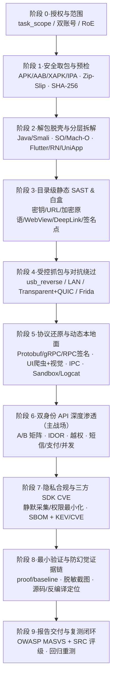
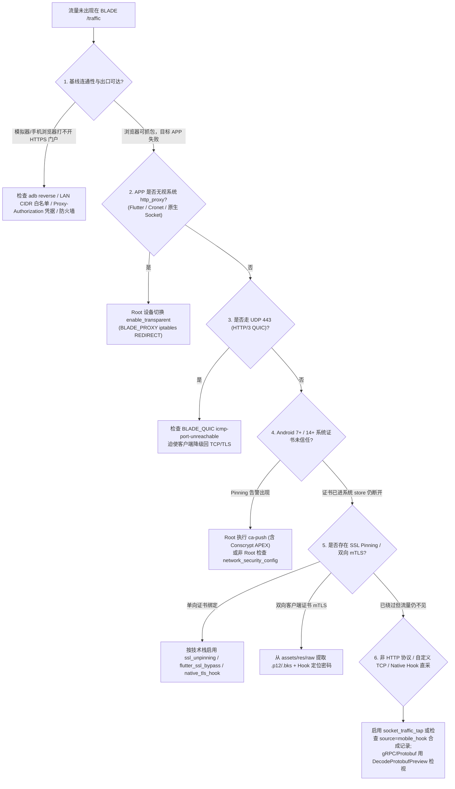

# 移动 APP 渗透全流程深度调研与工程实现方案（2026-11-28）

> **调研基线**：BLADE `07406acb`（2026-11-28） × Pojun `9465f00`（`v0.4.123+`，含 `#87` / `#97` / `#98`，2026-11-28）
> **适用目标**：Android（`.apk` / `.aab` / `.xapk` / `.apkm` / `.apks`）、iOS（`.ipa`）、跨平台与混合框架（Flutter / React Native / uni-app / Weex / Cordova / Electron / WebView H5 + 内嵌小程序容器）及配套后端 API。
> **文档性质**：只读勘察、全流程方法论调研与 P0 / P1 / P2 工程实现蓝图；所有 `file:line` 结论均已核对两仓源码，区分「BLADE 已落地底座」「与 Pojun/行业全流程差距」与「分期施工设计」。

---

## §0 执行摘要与两仓定位对比

### 0.1 核心结论

1. **思路本质**：移动 APP 渗透测试遵循「**安装包静态画像/反编译（拿地图与钥匙）→ 受控代理与对抗绕过（拿明文流量与运行时签名）→ 本地安全面与 IPC/WebView/沙箱测试 → 双账号后端 API 越权与业务逻辑测试（主战场）→ 可机验、多模态、脱敏的证据链与 SRC/MASVS 报告闭环**」。仅报告「未加固 / 可反编译 / 仅理论风险」无法通过高质量验收，必须以源码定位、实机状态变化或后端请求/响应对比作为实锤。
2. **BLADE 与 Pojun 在移动端呈强烈互补格局**：
   - **BLADE 强在原生运行时底座**：已建成 Go 原生包静态解析/SAST（`mobile/`）、三模式受控抓包与 Root `iptables` 透明引流（`traffic/mobile_*.go`）、10 套 Frida 模板 + `http_request(mobile_sign_method=...)` RPC 自动签名、有界 UI 状态机爬虫与 IPC Fuzz、`agent/mobile.go` 动态工具门控与前端「移动端工作台」。
   - **Pojun（`9465f00`）强在工程治理、白盒与 AI Harness 闭环**：在 `mini-program`、`apk-reverse` 实战体系基础上沉淀了「**安全解包防穿越 + 不信任工具退出码的产物门禁 + 目录级白盒四件套（`repo_map`/`taint_spec`/`sast_scan`/`code_trace`）+ 原生视觉（`view_image`）+ 13 项证据核查（`evidence_check`）+ 独立 Playbook 种子 + 速查块首语义单元无截断三态投影（`#87`）+ 收尾报告缺失实库校验（`#97`）**」。
3. **演进原则**：不推翻 BLADE 现有 `mobile/` + `traffic/` 运行时引擎，重点用 Pojun 的工程约束与 Harness 设计打通 **6 个核心断点**——反编译目录管线、Skill 默认绑定与路由、多模态截屏视觉、iOS 动态控制链、双账号鉴权矩阵自动化、以及 APP 专属证据闸门与报告交付模板。

### 0.2 两仓移动端与关联能力全景对照表

| 能力域 | BLADE 现状（`07406acb`） | Pojun 现状（`9465f00`） | 评估结论 |
| --- | --- | --- | --- |
| **大包上传与工作目录** | `server/app_upload.go` 支持 `1024 MiB` 流式落盘与 `.apk/.aab/.xapk/.apkm/.apks/.ipa`，20 分钟超时，归位 `tasks/<id>/samples/` | 主打聊天/任务上传 `.wxapkg`/`.zip`，128MB 限制；`server/artifacts.go` 放宽任务内相对路径入证 | **BLADE 领先**；需保留 1GiB 流式通道，补 zip 分包防穿越提取门禁 |
| **包格式静态与原生二进制分析** | `mobile/ingest.go` + `axml.go` + `plist.go` + `sast.go` + `types.go`：原生解析 AXML/bplist/mobileprovision、JAR v1+v2/v3、ELF/Mach-O 加固选项与 CryptID、14 款加壳、跨平台框架标签与 Hermes 串匹配 | 无 Go 原生 `mobile/`；靠 `skills/apk-reverse` 调 `jadx`/`apktool`，`skills/mini-program` 有 `wxapkg_safe.py` + `quality_gate.py` | **BLADE 基础扎实但浅**：SAST 仅在内存扫字节串，未自动调度 `jadx`/`apktool`/`blutter`/`hermes-dec` 出源码做语义审计 |
| **目录级白盒代码审计** | 仅在线 JS 工具 `agent/tools_jsaudit.go` | 白盒四件套 `agent/tools_code_audit.go`（`repo_map`/`taint_spec`/`sast_scan`/Semgrep/`code_trace`）+ `agent/tools_miniapp.go` (`miniapp_audit`) | **BLADE 重大缺口**：解包出 Java/Smali/JS 后缺少结构化路由/Sink/密钥白盒扫描工具 |
| **设备控制与抓包平面** | `mobile/device.go`（`adb` USB/Wi-Fi、Android <=13 及 14+ APEX Conscrypt `tmpfs` CA、Root `iptables` + `BLADE_QUIC`）；`traffic/mobile_proxy.go` + `mobile_transparent.go` + `mobile_ext.go`（LAN BasicAuth+CIDR、`.mobileconfig`、Pinning 告警、WS/SSE、Protobuf 预览） | 无内置 ADB / 透明代理 / 证书分发网关；靠外部代理 + 文档指引 | **BLADE 绝对优势**：抓包与对抗链路完整，但 `mobile/device.go` 全为 `adb`，尚未接入 iOS |
| **iOS 全链路测试能力** | 仅静态 `.ipa` 解析（`plist.go`、`sast.go`）+ `.mobileconfig` 生成；`Dockerfile:47` 已安装 `libimobiledevice-utils` | 仅 `skills/binary-mobile-reversing` 一页速查（`otool`/`strings`） | **双方均缺 iOS 动态链路**：BLADE 已有工具包但未接线 `ideviceinfo`/`iproxy`/越狱 Frida/Keychain |
| **Frida 与签名联动** | `mobile/frida.go` 内置 10 套脚本、`http_capture` 直写 `source="mobile_hook"`、`agent/mobile.go` + `agent/tools_http.go` 支持 `mobile_sign_method` RPC 自动签名并校验同主机名 | 依赖 `skills/apk-reverse/scripts/frida-run.sh` 手工脚本，无原生 HTTP 工具 RPC 联动 | **BLADE 领先**；缺“一次失败回退 + 重放攻击（nonce/timestamp）”验证模板 |
| **UI 自动化与多模态视觉** | `mobile/ui.go` + `mobile/audit.go` 有 `UIDump`、`CrawlUI`（<=40 步 + 危险文案拦截 + `traffic_delta`）、`ScreenCapture`；**但 Agent 工具未暴露截图，且无看图能力** | `agent/vision.go` + `view_image` 多模态看图（单轮<=6 张、防爆上限 guard + 非视觉模型自动占位降级） | **BLADE 断点**：`ScreenCapture` 与大模型视觉脱节，遇到验证码/滑块/WebView 停滞 |
| **Skill 体系与任务装配** | `db/db.go:681-684` `builtinSkillVisibility` 只绑定 `api-recon`、`coldcoffee`；`skills/apk-reverse/SKILL.md` 工具名与路径陈旧；`server/assembly.go:545` 有能力速查 | 26 个 Skill 全量绑定 + 守门测试；`#87` 速查无截断三态下发；`ops_tails.go:46-47` 代码硬路由；内置 `Playbook：APP 逆向 + API 渗透` 与 `微信小程序渗透` | **BLADE 严重断点**：内置移动端 Skill 默认不可见，缺 APP Playbook 种子 |
| **证据标准与报告交付** | `agent/tools.go` 逐字回验 + `traffic_refs`（`baseline/proof/verification`）+ `verify_evidence`；`report/` 通用漏洞导出，无 APP 专属元数据段 | `agent/tools_evidence.go` `evidence_check`（13 项检查 + `src_ready`）+ `db/findings.go` `FindingsMissingReport`（`#97`） | **BLADE 待补齐**：缺 APP 专属字段检查（SHA-256、ROM 版本、双账号脱敏对照）与 MASVS 覆盖矩阵 |
| **宿主工具清单检测** | `server/hosttools_api.go` 只读探测 27 项工具（含 `adb`/`jadx`/`apktool`/`aapt2`/`frida`/`objection`/`radare2`/`ideviceinfo`/`iproxy`） | `hosttools/hosttools.go` 含 `CatMobile`（`java`/`apktool`/`aapt`/`adb`/`jadx`/`killwxapkg`/`wedecode`/`frida`/`objection`）并支持安装 | **存在轻微漂移**：BLADE `Dockerfile:47` 装 `aapt` 而 `hosttools_api.go:40` 测 `aapt2` |

---

## §1 APP 渗透标准全流程方法论（10 阶段端到端闭环）

### 1.1 整体作业闭环架构



### 1.2 分阶段动作、产出契约与准出条件

| 阶段 | 核心目标 | 关键工具与动作 | 标准产出目录 / 节点 | 进入下一阶段门禁 |
| --- | --- | --- | --- | --- |
| **0. 前置与合规** | 锁定测试包、服务端边界与测试账号 | 写入 `task_scope` 候选后端域名；准备账号 A（普通）、B（同级）、C（高权/管理）及测试支付环境 | `task_scope`、`constraints`、账号凭据 `fact` | 授权范围明确；禁止无授权第三方域名 |
| **1. 安全取包与预检** | 防御恶意安装包破坏宿主并建立初始哈希锚点 | 流式上传（`<=1024 MiB`）；计算包体 SHA-256；识别 APK / Split APKs（XAPK/APKM/APKS）/ AAB / IPA；校验压缩条目不越界 | `tasks/<id>/samples/<app>`、`app` 资产节点、`PackageMetadata` | 包体完整可解；SHA-256 已登记；识别加壳与主跨平台框架 |
| **2. 解包与分层拆解** | 按技术栈精准切分分析路线，不死磕无效反编译层 | Android 跑 `jadx` + `apktool` + `.so` 提取；加壳样本识别壳名并转动态脱壳/Hook；Flutter 查 `libapp.so`；RN 查 `index.android.bundle`；iOS 检查 `FairPlay cryptid` | `tasks/<id>/samples/decompiled/{jadx,apktool,so,bundle}/` | 产出结构化文件索引与可读源码树或原生符号清单 |
| **3. 静态 SAST 与白盒** | 在抓包前先把“全部路由 + 密钥 + 签名嫌疑点 + 配置缺陷”摸清 | Manifest/Info.plist/Provisioning 规则审计；ELF/Mach-O 安全编译选项；接口域名、硬编码密钥（正则+Shannon 熵）、加密误用、组件暴露、WebView/Scheme | `mobile_audit/report.json`、`mobile_manifest` / `mobile_sast` 事实 | 候选端点进资产图；High/Medium 配置发现落 `fact` |
| **4. 抓包与对抗绕过** | 让 APP 与宿主机 MITM 之间产生完整明文 HTTP/WS/gRPC 流量 | 默认 `adb reverse`；无法读系统代理时启 Root `iptables` 透明代理 + `BLADE_QUIC` 阻断；Android 14+ 用 Conscrypt APEX 挂载系统 CA；Pinning/Flutter 启用 `ssl_unpinning` / `flutter_ssl_bypass` / `native_tls_hook` | `traffic` SQLite 索引（`source=mobile` / `mobile_hook`） | 至少捕获登录与 1 条核心业务请求的完整 Header+Body 明文 |
| **5. 协议与客户端动态面** | 覆盖“客户端独有风险面”并解析出后端调用所需的加密/签名钥匙 | Frida `crypto_monitor` + `rpc.exports` 导出签名；UI 状态机爬虫 + 截图视觉补充；`FuzzIPC` 扫 Activity/Service/Receiver/Provider/DeepLink；Root 沙箱 + Logcat 审计 | Frida RPC 会话、UI 覆盖树与截图、IPC 报告、Sandbox/Logcat 报告 | 若后端带签名，实现 `http_request(mobile_sign_method=...)` 或独立脚本可复算 |
| **6. 双账号 API 渗透** | 围绕后端接口做决定胜负的深度漏洞挖掘 | `extract-session` 聚类令牌；用 A/B/匿名/过期/管理员五态批量重放高价值接口（认证、订单、资金、上传下载、导出、管理接口）；测试并发竞争与状态机跳过 | `traffic_refs`（`proof` + `baseline`）与最小化数据证明（`<=5` 条脱敏样本） | 核心接口全部完成鉴权与参数边界验证 |
| **7. 隐私合规与 SDK CVE** | 兼顾安全合规要求与三方组件历史漏洞 | 监测「首次启动未点同意前」的外发请求（对比抓包时间戳与隐私弹窗）；核对实际请求采集字段（IMEI/OAID/位置/通讯录/剪贴板）与隐私声明；基于 SBOM 查 `lookup_cves` | 隐私合规核对表、SDK/组件版本与 CVE 关联 `fact` | 区分“仅版本号存在”与“存在可触发调用链/漏洞证明” |
| **8. 证据链与防幻觉校核** | 消除误报、仅静态推断当高危与客户端假漏洞 | 核对 13 项证据完整度；确保敏感数据/秘钥在报告脱敏而 `fact` 保真；验证后端状态确实变化；核实所有引用的文件/行号/流量 ID 为本次真实输出 | `evidence` 节点、绑定截图、脱敏日志与复现命令 | 通过逐字回验与 APP 专属证据检查，无空口 `critical/high` |
| **9. 报告交付与复测** | 输出可直接递交企业/众测 SRC 的专业交付物 | 按 `Package + SHA-256 + 测试机环境 + MASVS + 复现步骤 + A/B 对照 + 影响 + 修复` 渲染 `Markdown`/`DOCX`；修复新包进回归复测 | 交付报告、MASVS 覆盖摘要、`finding` 复测状态机 | 零缺失报告漏洞（对齐 `FindingsMissingReport`），高危项可一键复现 |

### 1.3 标准化任务产物目录契约

为解决各步骤工具输出分散到 `/tmp` 或被按轮次清理的问题，所有 APP 静态、反编译与取证产物统一按任务根目录持久化（严格限定在 `tasks/<id>/` 内，严禁越界读写）：

```text
tasks/<task_id>/
  uploads/                      # 对话或创建任务时附加的说明材料/抓包导流文件
  samples/                      # appUpload 落盘的原始 APP 安装包（保留原始 SHA-256 只读起点）
    app.apk / app.ipa
    unpacked_splits/            # XAPK / APKM / APKS 解析出的 base.apk 与 split_*.apk
    decompiled/                 # （P0 新增规范）统一反编译工作区
      jadx/                     # jadx 输出 Java 源码与标准化 AndroidManifest.xml
      apktool/                  # apktool 输出 smali、res/values、assets
      native_so/                # 提取的 lib/<abi>/*.so 与符号摘要
      cross_platform/           # Flutter/RN(Hermes)/uni-app/Cordova/Electron 解包产物
      payload_ios/              # IPA 解压 Payload/*.app、Info.plist、embedded.mobileprovision
  mobile_audit/                 # （P0 新增规范）目录级白盒扫描产物
    manifest.json               # 包元信息、工具版本、解包完整率、质量 warnings
    report.json                 # 路由、API、密钥、签名候选、组件与风险明细
    endpoints.txt               # 方法 + URL + 来源 file:line
    secrets.txt                 # 脱敏密钥 + Shannon 熵 + 上下文 file:line
  screenshots/                  # （P0 新增规范）UI 交互与爬虫截取的 PNG 屏幕证据（供 view_image 与报告引用）
  shared/scripts/               # 签名重算脚本、Frida 自定义 RPC JS、接口批量越权脚本
```

### 1.4 阶段关键实战要点（静态 + API 主战场）

#### A. 加密/签名算法定位五步法
1. **全局关键词搜索**：`sign`、`signature`、`hmac`、`nonce`、`timestamp`、`Authorization`、`encrypt`、`AES/GCM`、`RSA/ECB`、`Interceptor`、`addHeader`。
2. **定位拦截器与网关封装**：Android 中优先看 `okhttp3.Interceptor.intercept()`、`Retrofit` 注解及统一响应/请求拦截器；iOS 中搜 `NSURLSession`、`AFHTTPSessionManager`、`Alamofire RequestInterceptor`。
3. **跨层分流判断**：若 Java/ObjC 层调用 `native` 方法且存在 `System.loadLibrary("...")`，**停止死磕反编译代码**，直接切入 Native `.so` 的 `JNI_OnLoad` / `Java_*` 函数或直接使用 Frida Hook 签名入参/返回值与 `rpc.exports`。
4. **复用签名**：优先在 Frida 脚本导出 `rpc.exports.sign(method, url, body)` 供 BLADE `http_request(mobile_sign_method=...)` 原生联动；仅在算法极简单时用 Python 在 `shared/scripts/` 复现，减少维护成本。
5. **重点验证服务端校验漏洞**：常出现「客户端费力加签，但服务端未校签名 / 不校 timestamp 重放窗 / 仅校验部分字段 / 忽略非 JSON Content-Type / 对老版本 `/v1/` 接口不校验」的情况。

#### B. 双身份越权与高频高危业务逻辑清单
| 测试维度 | 常见参数与触发点 | 实操测试动作（遵守最小化样本 `<=5` 条） |
| --- | --- | --- |
| **登录与验证码认证** | 短信验证码、邮箱重置、一键登录、OAuth/微信关联、手势/生物识别解锁 | 验证码回显与 4/6 位爆破（测前核对限频）、删除/置空验证码参数、A 账号获取验证码提交给 B 账号绑定的手机号、服务端仅信客户端 `authSuccess=true`（改客户端响应包无效则排除，改服务端入参成功则实锤）、退出登录后旧 Token 仍有效 |
| **水平越权 (IDOR)** | `userId`、`memberId`、`orderNo`、`addressId`、`fileId`、`invoiceId` | 用账号 A 的 `Authorization/Cookie` 重放账号 B 的读、改、删、导出请求；枚举导出 PDF/电子发票/病历/合同 URL；测试 `GraphQL` 嵌套节点与批量查询数组 `ids=[A,B]` |
| **垂直越权** | 管理配置接口、审核通过/驳回、员工导出、内部测试域名 | 普通 APP 账号调用反编译出的管理/运营后台路径、添加 `role=admin` / `isAdmin=1` 批量赋值参数 |
| **支付与资产交易** | 商品价格、数量（负数/浮点小数）、优惠券/积分叠加、余额并发 | 修改单价/折扣/数量绕过总额校验；订单与实际支付账户交叉替换；并发请求同一领券/提现/兑换接口（检测锁缺失）；伪造第三方支付回调异步通知（仅测试环境/沙箱） |
| **文件与对象存储** | 头像/证件上传、APP 内部导出下载、OSS/COS 直传 STS Token | 客户端硬编码永久 OSS/COS/S3 AK/SK 或过度宽泛的 STS 临时策略（可 List/Put/Delete 非本目录）；下载接口 `fileId/path` 穿越；上传 HTML/SVG 造成同域存储型 XSS |

---

## §2 难点专项深调研：iOS、跨平台混合、抓包排障与重打包

### 2.1 iOS 专项全流程（静态已有 → 动态补齐设计）

当前 BLADE 仅覆盖 iOS 静态解析（`mobile/plist.go` 解析 XML/`bplist00` 与 `embedded.mobileprovision`、`CheckMachOFairPlayEncrypted` 与 `InspectMachOBinary`）和 `.mobileconfig` 生成（`traffic/mobile_ext.go:113`），完整 iOS 评估链路还需贯通以下 6 个环节：

1. **取包与 FairPlay 加密判定**：
   - App Store 下载安装包通常带 FairPlay 加密（`Mach-O` `LC_ENCRYPTION_INFO*` 中 `cryptid > 0`），BLADE 静态识别后应明确提示**不可直接反编译业务符号**，需通过越狱设备执行 `frida-ios-dump` / `bagbak` 内存砸壳后重新入库（企业签/测试包 `cryptid == 0` 可直接提取 Swift/ObjC 类信息 `class-dump` / `ipsw` / `radare2` / Ghidra）。
2. **USB 通道映射与证书分发**：
   - `Dockerfile:47` 已安装 `libimobiledevice-utils`（`ideviceinfo`、`iproxy` 等）。动态层通过 `iproxy <local_ssh_port> 22 -u <udid>` 建立 SSH 与 Frida 端口映射（`27042`），替代纯局域网依赖。
   - 证书信任：通过 BLADE 门户或 `/api/traffic/ca?fmt=mobileconfig` 下发安装后，**iOS 必须提示并引导测试员两步启用**：`设置 → 通用 → VPN与设备管理`（安装描述文件）→ `关于本机 → 证书信任设置`（开启完全信任根证书）。
3. **iOS SSL Pinning 与 Root/越狱对抗**：
   - Pinning 常见于 `NSURLSessionDelegate` (`didReceiveChallenge`)、`AFSecurityPolicy`、`Alamofire ServerTrustEvaluating`、`TrustKit`、`Security.framework SecTrustEvaluate*`。越狱下可用 Frida Hook `SecTrustEvaluate` / `SecTrustEvaluateWithError` / `SSLSetSessionOption` 或 `objection -g <BundleID> ios sslpinning disable`。
4. **iOS 沙箱与 Keychain 高危敏感面**：
   - **Keychain**：即使卸载重装后数据仍可能残留（`kSecAttrAccessibleAfterFirstUnlock` / `Always` 配置过松、未设生物/锁屏保护）；越狱下用 `objection` `ios keychain dump` 读取核验。
   - **本地持久化与缓存**：`/var/mobile/Containers/Data/Application/<UUID>/` 下的 `Library/Preferences/*.plist`（`NSUserDefaults`）、`Library/Caches/Snapshots/`（切后台系统自动截屏缓存敏感页面，对应需检查是否覆盖遮罩）、`Cache.db`（`NSURLCache` 可能明文持久化 HTTPS 响应体）、`Cookies.binarycookies` 及 `Pasteboard` 剪贴板。
5. **URL Scheme 与 Universal Links**：
   - 检查 `Info.plist` `CFBundleURLTypes` 劫持风险（多 APP 声明同 Scheme）与 `embedded.mobileprovision` 中的 `applinks:`（`apple-app-site-association` JSON 文件是否泄露内网或隐藏路径）；验证外部传入 `application(_:open:options:)` 的参数是否直接拼进 `WKWebView loadRequest` 或触发无确认的支付/绑定动作。

### 2.2 跨平台与混合容器专项技术路线

| 框架 / 容器类型 | BLADE 识别特征（`mobile/ingest.go:54-71`） | 核心资产与代码还原路径 | 专有攻击面与静态/动态突破口 |
| --- | --- | --- | --- |
| **Flutter (Dart AOT)** | `libflutter.so`、`Flutter.framework/`、`libapp.so` | ① 抓包绕过：用 BLADE `flutter_ssl_bypass` Hook `libflutter.so` 内 BoringSSL `ssl_crypto_x509_session_verify_cert_chain` 或开 `enable_transparent`；② 逆向：使用 **`blutter`**（基于对应 Dart SDK 还原 `libapp.so` 函数名、字符串与类偏移树） | **不走系统代理**是默认行为（Dart HttpClient 原生 socket）；`libapp.so` 含全量 API 路径、加密逻辑与三方 SDK Key；`PlatformChannel` (`MethodChannel`) 原生桥接参数注入 |
| **React Native** | `libreactnativejni.so`、`index.android.bundle`、`main.jsbundle` | 明文 JS Bundle 直接可读 / 美化；若 `HermesBytecode=true`（`hermesMagicBytes`）→ 使用 `hermes-dec` / `hbctool` 反汇编/反编译还原 JS 逻辑与 API 常量 | Hermes 字节码中常残留完整 REST/GraphQL Endpoint、内网调试 URL、OSS Key 及前端签名盐；`Linking` DeepLink 路由直通敏感 Screen |
| **uni-app / Weex** | `assets/apps/__uni__`、`libweex` | 解压 `assets/apps/__uni__*/www/` 即可见明文/加密打包 H5/JS 资源（`app-service.js`、`manifest.json`）；若启用 V8 快照或加密需定位 `dcloud` 解密点 | `__uni__` 资源包内 API、本地存储 `plus.storage`、扩展 API `plus.runtime` / `uni.navigateTo` 参数可控导致任意 WebView 跳转 |
| **WebView Hybrid** | `addJavascriptInterface`、`setAllowFileAccess`、`shouldOverrideUrlLoading` | Hook `webview_bridge` 监控所有 `loadUrl` / `evaluateJavascript` 传参；静态审计 `WebSettings` 安全项 | ① `setJavaScriptEnabled(true)` + `@JavascriptInterface` 在任意非受信任 URL 加载下触发敏感原生能力调用或低版本 RCE；② `setAllowFileAccessFromFileURLs(true)` / `setAllowUniversalAccessFromFileURLs(true)` 配合 Scheme 传入 `file:///data/data/...` 跨文件窃取沙箱凭证；③ URL 白名单校验绕过（如 `url.contains("trusted.com")`、`startsWith` 未校验域名边界） |
| **Cordova / Electron (桌面/混合端)** | `assets/www/cordova.js`、`libelectron` | 解包 `assets/www/` 或 `npx asar extract app.asar` 审计 `preload.js`、主进程 `ipcMain`、渲染进程 `nodeIntegration` / `contextIsolation` | 跨端渲染器暴露 `ipcRenderer` / `cordova.exec`、远程 URL 加载后逃逸执行本机命令 |
| **APP 内嵌微信小程序/开放容器** | 含微信/支付宝 SDK 及小程序跳转 ID / 扩展缓存（或用户同时给出 `.wxapkg`） | **直接借鉴 Pojun `skills/mini-program`**（`wxapkg_safe.py` V1MMWX 解密 + `wedecode`/`KillWxapkg` 质量解包 + `miniapp_audit` 目录审计） | APP 与小程序共享账号体系时存在 **AppID/OpenID/UnionID 映射混乱**、JSBridge 透传 APP Token 给三方 H5/小程序、云开发未授权读取（详细方法论见 Pojun `小程序渗透方法论调研-2026-11-23.md`） |

### 2.3 受控抓包平面与「抓不到包」8 层排障决策树

当移动端发包无流量进入 BLADE `:9899` 流量库时，按以下从底层到应用层的固定顺序排查（避免盲目修改 Frida 脚本浪费时间）：



### 2.4 重打包与抗篡改验证边界

当无 Root 设备、目标强混淆难以单纯通过 Frida attach 生效、或需验证「篡改验证 / `debuggable` / 弱证书校验风险」时，采用标准重打包管线（`skills/apk-reverse/scripts/rebuild-sign-install.sh`）：
1. **前提校验**：仅针对授权评估样本用于分析验证；禁止去除版权校验用于分发盗版。
2. **标准命令顺序**：`apktool d -r app.apk -o apktool_out`（必要时 `-r` 保留资源减少回编失败）→ 最小化修改 `AndroidManifest.xml`（如追加 `<trust-anchors><certificates src="user"/></trust-anchors>`）或 Patch Smali 判定分支 → `apktool b apktool_out -o raw.apk` → **`zipalign -f -p 4 raw.apk aligned.apk`（必须先对齐再签名，否则破坏 v2/v3 签名块！）** → `apksigner sign --ks debug.keystore --out signed.apk aligned.apk` → `apksigner verify --print-certs signed.apk`。
3. **重打包反篡改检测点**：观察重打包后 APP 是否验证签名 SHA-256（防二次打包）或出现服务端强绑定校验缺失；若轻易被重打包并正常接入业务 API，可构成 **MASVS-RESILIENCE** 风险线索（定级通常为 Low/Info，需结合实际业务可利用后果如恶意劫持或伪造数据包评估）。

---

## §3 OWASP MASVS v2 对照与国内 SRC 定级/驳回防错

### 3.1 OWASP MASVS v2 7 大安全域与 BLADE 检测覆盖映射

| MASVS v2 控制域 | 核心安全要求 | 静态检测手段 | 动态与服务端实证手段 | BLADE 覆盖现状 |
| --- | --- | --- | --- | --- |
| **MASVS-STORAGE** | 敏感凭证/PII 不得明文落 SharedPreferences/Plist/SQLite/外部存储/Logs/截图缓存/Backup | `allowBackup`、`requestLegacyExternalStorage`、日志/文件/数据库 API 审计 | `mobile_app_ctrl(sandbox_audit/logcat_audit)` + `adb backup`；iOS Keychain / NSURLCache / Snapshots | Android 完善；iOS 待补 |
| **MASVS-CRYPTO** | 不得硬编码密钥；禁弱算法（ECB/MD5 加密口令/固定 IV/非 `SecureRandom`） | 硬编码密钥正则 + Shannon 熵 + 加密原语规则 | `frida crypto_monitor` 运行时抓明文密钥、IV 与算法参数，反证硬编码密钥真实可解密通信或调用第三方云服务 | 静态偏粗正则；动态有效 |
| **MASVS-AUTH** | 客户端生物认证/本地锁不得仅靠布尔返回绕过；Token 周期管理与服务端强校验 | 登录/生物认证回调/Token 刷新源码定位 | Frida 篡改本地生物认证回调；**A/B 双账号矩阵验证后端是否只信客户端状态** | 缺自动化 A/B 鉴权矩阵 |
| **MASVS-NETWORK** | 全链路 TLS、禁任意证书信任、合理配置 ATS/NSC、高危业务建议 Pinning | `usesCleartextTraffic`、`nsc-trust-user-ca`、`NSAllowsArbitraryLoads` | `ca-push` + Pinning 告警检查 + `ssl_unpinning` 验证；重放明文流量与禁用校验路径 | **非常完整** |
| **MASVS-PLATFORM** | IPC 组件最小导出、DeepLink/WebView URL 白名单校验、`PendingIntent` 与 Task 隔离 | Exported 列表、Permission 缺失、`taskAffinity`、`addJavascriptInterface` 检查 | `mobile_ipc_probe(auto_fuzz)` 批量投喂 Activity/Service/Receiver/Provider/DeepLink 并监控 `SecurityException` 与 Logcat | Android 完善；WebView RCE 待细化 |
| **MASVS-CODE** | RPATH/PIE/NX/Canary/RELRO；第三方 SDK 组件及时升级；禁注入原语（SQLite `rawQuery`/JS eval） | ELF/Mach-O 加固审计 + SBOM 线索提取 + 源码/反编译危险 Sink | `lookup_cves` 对接三方组件 CVE（如旧 OkHttp/Fastjson/WebView 内核）并通过 PoC 验证可达性 | 缺 Semgrep 污点链（建议借鉴 Pojun `sast_scan`） |
| **MASVS-RESILIENCE** | 正式包关闭调试（`debuggable`/`get-task-allow`）、具备基础防篡改/反调试（视业务合规需求） | APK v1-only Janus、`debuggable=true`、`get-task-allow=true` | `anti_detection`、重打包登录验证（仅作加固成熟度参考，不夸大成高危漏洞） | 完善（需防定级虚高） |
| **扩展：隐私与合规** | 同意前不得收集设备标识符/位置/通讯录/安装列表；三方 SDK 数据最小化 | `permissions` + 隐私 SDK 主机（`thirdPartySDKHostSuffixes`）扫描 | 对比“首次启动点击同意前”的 MITM 流量抓包与权限调用记录（Frida Hook 敏感 API） | 静态仅列出列表；缺动态“同意前采数”对比 |

### 3.2 APP 报告与 Web 报告差异及国内 SRC 常见驳回防错清单

对比 Pojun [11-reporting.md](file:///home/kali/Code/Pojun/skills/mini-program/references/11-reporting.md) 与 [小程序渗透竞品调研-2026-11-23.md](file:///home/kali/Code/Pojun/docs/小程序渗透竞品调研-2026-11-23.md) 调研经验，APP 漏洞报告必须额外包含与规避以下要点：

1. **必备元信息头部（Web 报告缺失项）**：应用名称 + 包名/Bundle ID + 版本号（`versionName`/`versionCode`）+ 原始包 **SHA-256** + 测试设备型号 & OS/ROM 版本（如 `Pixel 6 · Android 14`）+ 是否启用代理/Hook 及具体 Hook 点或 Patch 位置（保证复审人员可 100% 复现）。
2. **严厉禁止被驳回的“伪高危”结论**：
   - ❌ **仅报告“可反编译 / 未加固 / 可调试 / allowBackup”当高危**：绝大多数 SRC 视「App 反编译风险」为忽略或 Info/Low；必须进一步拿反编译结果证明 **硬编码了有效外部 AKSK / 可利用的后端未授权越权接口 / 可盗取他人的敏感业务数据**。
   - ❌ **仅修改客户端本地状态（如 Frida 篡改 `isVip=true` 展示 VIP 图标或改响应包显示支付成功）**：客户端自欺欺人无效；必须证明 **后端接口接受了非法参数、未校验签名或返回了真实非本人付费资源/修改了数据库订单状态**。
   - ❌ **在非授权三方域名测试或批量拖库**：硬编码域名若归属第三方（如统计 SDK、友商开放平台），仅可做归属核实与脱敏最小验证，严禁超出 `task_scope` 压测；IDOR 证明读取样本 **<= 5 条** 敏感记录即可。
   - ❌ **只贴脱敏截图无原始流量/命令或源码位置**：需满足 `report_finding` 逐字证据回验 + 成对流量（`proof` + `baseline`）+ 源码 `file:line` 或脱敏截图（`screenshots/`）。

---

## §4 BLADE 源码实勘与 Pojun `9465f00` 精准映射

通过实读 BLADE 仓库源码与 Pojun 最新提交 `9465f00`，确认以下 **7 处关键工程断层（已标定准确 `file:line`）**，是下阶段 P0/P1 开发改造的精确锚点：

### 4.1 断层 1：内置移动 Skill 缺默认可见性与目录/工具名陈旧
- **BLADE 实勘**：
  - [db/db.go:681-684](file:///home/kali/Code/BLADE/db/db.go#L681-L684) `builtinSkillVisibility` 目前只默认绑定 `api-recon` 和 `coldcoffee`，仓库中已有的 `skills/apk-reverse` 与 `skills/binary-mobile-reversing` **默认对 `pentest` 和 `worker` 均不可见**，Agent 无法在 APP 任务中主动加载方法论！
  - [skills/apk-reverse/SKILL.md:19,23,44-46,56,108,136](file:///home/kali/Code/BLADE/skills/apk-reverse/SKILL.md#L19-L23) 与 Pojun 版对比存在工具名漂移（写着旧工具 `lookup_cves` / `run_execution`，未对接 BLADE 7 个原生 `mobile_*` 工具和 `tasks/<id>/samples/`），且第 44–46 行使用裸相对路径 `bash scripts/decode.sh`——当 Worker 位于运行目录 `tasks/<id>/i<N>` 时该路径失效。
- **Pojun `9465f00` 可借鉴**：
  - [server/prompt_chain.go:100-109](file:///home/kali/Code/Pojun/server/prompt_chain.go#L100-L109)（`#87`）：取消 Skill 描述的字符硬截断，改为提取「首个语义单元」并向模型/页面如实下发 `index_state: described | name_only | absent`；
  - [skills/mini-program/SKILL.md:26-30](file:///home/kali/Code/Pojun/skills/mini-program/SKILL.md#L26-L30)：所有随技能脚本严格采用 `bash "${SKILL_DIR}/scripts/..."` 绝对引用，彻底规避 runDir CWD 漂移；
  - [docs/小程序渗透平台集成勘察-2026-11-23.md:56-62](file:///home/kali/Code/Pojun/docs/小程序渗透平台集成勘察-2026-11-23.md#L56-L62)：加入单测守门校验（每个随包 Skill 必须有绑定或显式 optOut、`SKILL.md` frontmatter 可解析、速查覆盖）。

### 4.2 断层 2：缺乏自动化反编译与目录级白盒代码审计管线
- **BLADE 实勘**：
  - [mobile/ingest.go:113-170](file:///home/kali/Code/BLADE/mobile/ingest.go#L113-L170) 与 [mobile/sast.go:495-545](file:///home/kali/Code/BLADE/mobile/sast.go#L495-L545) 直接流式读取 ZIP 内 DEX、SO、XML 字节做正则匹配。未经过 `jadx` 反编译的 Dalvik 字节码无法直接匹配 Java 方法调用链（如 Retrofit 注解、自定义 AES Key 构造、WebView `addJavascriptInterface` 与上下文变量），导致静态深度明显不足。
  - 当前未绑设备的移动端任务（[agent/mobile.go:275](file:///home/kali/Code/BLADE/agent/mobile.go#L275)）只能依赖通用文本提示让 LLM 手工调用 `Bash (jadx / apktool ...)`，缺乏产物目录约定、质量门禁与结构化 `report.json` 输出。
- **Pojun `9465f00` 可借鉴**：
  - [agent/tools_code_audit.go:1-120](file:///home/kali/Code/Pojun/agent/tools_code_audit.go#L1-L120) 白盒四件套（`repo_map` + `taint_spec` + `sast_scan` + `code_trace`）：路径严格锁定在 `tasks/<id>/`，不经过 shell 直接驱动扫描并把结构化热点落盘；
  - [docs/小程序渗透能力完整方案-2026-11-23.md:163-186](file:///home/kali/Code/Pojun/docs/小程序渗透能力完整方案-2026-11-23.md#L163-L186)：`wxapkg_safe.py` + `quality_gate.py` 原则——**绝不轻信外部反编译器返回码 `0`**，解包前先做路径穿越（`..`、绝对路径、符号链接）检查，解包后以核心文件非空率、`AndroidManifest`/关键路由可解析率判定完整度。

### 4.3 断层 3：UI 截图与视觉大模型闭环断裂
- **BLADE 实勘**：
  - [mobile/ui.go:140-161](file:///home/kali/Code/BLADE/mobile/ui.go#L140-L161) 已完整实现 `Manager.Screenshot(ctx, serial)` 并被前端 HTTP `GET /api/tasks/{id}/mobile/screen` 调用，但 **`agent/mobile.go:124-160` 的 `mobile_ui_explore` 仅允许 `dump | auto_crawl | launch | deeplink | tap | input | swipe | back | home | force_stop`**，Agent 完全拿不到屏幕图像；
  - BLADE 也缺少类似 Pojun 的图像 Block 传入与看图工具，在面对图形验证码、手势滑块、WebView 页面（`uiautomator dump` 控件缺失）或支付/弹窗截屏取证时处于“盲操作”状态。
- **Pojun `9465f00` 可借鉴**：
  - [agent/vision.go:1-120](file:///home/kali/Code/Pojun/agent/vision.go#L1-L120)：`view_image`（支持读取 `tasks/<id>/` 内截图送入视觉模型，单请求最多保留最新 6 张、`<=5MB`），外层 `VisionGuard` 自动对纯文本 Profile 将图像 Block 降级为文本占位，保证低成本无报错兼容。

### 4.4 断层 4：iOS 动态全链路空白，宿主环境存在工具校验错位
- **BLADE 实勘**：
  - [Dockerfile:47](file:///home/kali/Code/BLADE/Dockerfile#L47) 已预先安装 `libimobiledevice-utils`（提供 `ideviceinfo`、`iproxy`）和 `aapt`；
  - 然而 [mobile/device.go](file:///home/kali/Code/BLADE/mobile/device.go#L34-L120)、[mobile/ui.go](file:///home/kali/Code/BLADE/mobile/ui.go#L106-L249)、[mobile/audit.go](file:///home/kali/Code/BLADE/mobile/audit.go) 全部仅封装 `adb`，前端设备列表与绑定流程无法纳管 USB 连接的越狱 iOS 设备；
  - [server/hosttools_api.go:40](file:///home/kali/Code/BLADE/server/hosttools_api.go#L40) 探测 **`aapt2`**，但 [Dockerfile:47](file:///home/kali/Code/BLADE/Dockerfile#L47) 实际安装的是 Debian **`aapt`**，会导致容器健康检查误报缺失 `aapt2`。

### 4.5 断层 5：缺少预置任务 Playbook 种子与未绑设备自动赋能
- **BLADE 实勘**：
  - [server/assembly.go:774-777](file:///home/kali/Code/BLADE/server/assembly.go#L774-L777) 严格依赖 `task_mobile_device` 绑定设备才放行 7 个 `mobile_*` 工具，思路正确（不污染常规 Web 任务），但对于**“用户只上传了 APK/IPA、暂时无真机”**的任务，当前缺乏内置的“APP 静态深度逆向 + API 渗透”标准任务 Playbook 模板引导 Planner。
- **Pojun `9465f00` 可借鉴**：
  - [db/task_playbook_seed.go:64-82,101-143](file:///home/kali/Code/Pojun/db/task_playbook_seed.go#L64-L143)：预置「Playbook：APP 逆向 + API 渗透」与「Playbook：微信小程序渗透」，且采用独立批次 settings flag（`task_playbooks_v2`）避开老库升级跳过坑。

### 4.6 断层 6：双账号 A/B 越权自动化与协议签名边界
- **BLADE 实勘**：
  - [server/mobile_api.go](file:///home/kali/Code/BLADE/server/mobile_api.go#L628) 的 `/extract-session` 聚类出最近流量中的认证 Header/Token；[agent/mobile.go:293-352](file:///home/kali/Code/BLADE/agent/mobile.go#L293-L352) `http_request` 已支持 `mobile_sign_method` + 同主机反 SSRF 守卫。
  - 短板在于：**单人登录抓包只能抽出一套会话**，缺少将「账号 A 与账号 B 两套抽取凭据」自动持久化成结构化 `session` 供 `session_login` / `auth_request` / `diff_responses` 批量跑越权矩阵的桥接。

### 4.7 断层 7：APP 专属证据核查与报告输出模板缺位
- **BLADE 实勘**：
  - [report/report.go](file:///home/kali/Code/BLADE/report/report.go)、[report/findings.go](file:///home/kali/Code/BLADE/report/findings.go) 尚未识别任务的 `TaskMobileConfig`（包名 / SHA-256 / 平台 / 静态 SAST 统计 / 设备环境），也未针对移动漏洞提供基于 MASVS 的覆盖率清单或截图/产物锚定段落。
- **Pojun `9465f00` 可借鉴**：
  - [agent/tools_evidence.go:73-105](file:///home/kali/Code/Pojun/agent/tools_evidence.go#L73-L105) `evidence_check` 对每条漏洞给出 `SRCReady` 布尔结论及缺失项建议；
  - [db/findings.go](file:///home/kali/Code/Pojun/db/findings.go) + `#97` `FindingsMissingReport(taskID, limit)` 直接核查数据库真实 `report` 列（含全空白串校验，排除 `duplicate` 与已合并项），在任务收尾强制提醒补全缺失的详情报告。

---

## §5 分阶段工程实现方案（P0 / P1 / P2）

### 5.1 架构演进总览

```mermaid
flowchart LR
    subgraph P0["P0 · 打通核心闭环（立即可施工）"]
        P0A["1. 修复并默认绑定 apk-reverse / binary-mobile-reversing<br/>对齐 #87 SkillIndex 无截断投影"]
        P0B["2. 新增 Playbook：移动 APP 全流程渗透<br/>独立 settings flag seed"]
        P0C["3. 新增 mobile_decompile_and_audit 工具<br/>安全解压 + jadx/apktool + 目录白盒扫描"]
        P0D["4. 打通 UI screenshot + view_image 多模态<br/>修正 aapt/aapt2 探测错位"]
        P0E["5. extract-session 多账号角色标记 + APP evidence_check"]
    end

    subgraph P1["P1 · 全端覆盖与交付升级"]
        P1A["1. iOS 动态控制桥 (ideviceinfo/iproxy/SSH/Keychain)"]
        P1B["2. 跨平台专项反编译 (blutter / hermes-dec / uni-app)"]
        P1C["3. report/ 移动 APP 元信息卡 + 截图附件 + MASVS 矩阵"]
        P1D["4. 隐私合规“同意前外发流量”自动化比对审计"]
    end

    subgraph P2["P2 · 强对抗与资产级演进"]
        P2A["1. 加壳样本沙箱自动脱壳 (frida-dexdump)"]
        P2B["2. Protobuf / gRPC 启发式解码重构与重放编辑"]
        P2C["3. 跨版本 APK/IPA 攻击面增量 Diff"]
    end

    P0 --> P1 --> P2
```



### 5.2 P0：打通工具–技能–Playbook–视觉–证据闭环（详细施工规范）

#### P0-1. 技能升级、默认绑定与速查保真
- **修改 `db/db.go:681-684` `builtinSkillVisibility`**：
  - 新增默认绑定 `"apk-reverse": {"pentest", "worker"}`、`"binary-mobile-reversing": {"pentest", "worker"}`（insert-if-absent，不覆盖用户手动关闭）。
- **升级 `skills/apk-reverse/` 与 `skills/binary-mobile-reversing/`**：
  - 将 `skills/apk-reverse/SKILL.md` 内所有脚本调用改为 `bash "${SKILL_DIR}/scripts/decode.sh" --out "<taskRoot>/samples/decompiled" ...`；
  - 将「与本平台的衔接」表全面更新为 BLADE 真实工具：`mobile_device_status`、`mobile_app_ctrl`、`mobile_proxy_ctrl`、`mobile_ui_explore`、`mobile_frida_hook`、`mobile_rpc_sign`、`mobile_ipc_probe`、`http_request(mobile_sign_method=...)`、`report_finding`、`lookup_cves`；
  - 参考 Pojun `skills/mini-program/references/` 在 `skills/apk-reverse/references/` 新增：`05-cross-platform-hybrid.md`（Flutter / RN / uni-app / WebView）、`06-privacy-sdk-checklist.md`（隐私合规核查表）、`07-mobile-reporting-and-src.md`（APP 定级与 SRC 驳回防错）。
- **对齐 Pojun `#87` 与路由引导**：
  - 在 `server/assembly.go` 能力速查块放开 `apk-reverse` / `binary-mobile-reversing` 描述首个完整语义单元不被字符数腰斩，并在 `agent/planner.go` / `agent/worker.go` 依据 `hasApp` 自动提示优先加载对应 Skill。
  - 增加守门单测（借鉴 `Pojun/db/skill_visibility_test.go`）：验证随仓 Skill 均有默认绑定或显式声明，且全部 `.md` 与 `.py` 不含品牌敏感词。

#### P0-2. 新增目录级反编译与白盒扫描工具 `mobile_decompile_audit`
- **设计动机**：弥补 `mobile/ingest.go` + `mobile/sast.go` 不进源码语义层的缺口；同时避免篡改既有 `js_audit` 的 required schema。
- **建议落点**：`mobile/decompile.go` + `agent/tools_mobile_audit.go`（在 `WorkerTools` 与 `MainAgentTools` 注册；**只要 `hasApp == true` 即可调用，不要求已绑定真机**！）。
- **核心参数与执行流**：
  ```json
  {
    "sample_path": "samples/app.apk",
    "mode": "auto | fast | deep",
    "skip_apktool": false,
    "decompile_native_strings": true
  }
  ```
  1. **路径与安全边界**：只允许读取并输出到当前 `tasks/<id>/` 内（`filepath.Rel` 严格校验，拒绝 `..` 与符号链接穿越）；若为 `.xapk/.apkm/.apks` 先安全解压归并 split APKs。
  2. **质量门禁（不轻信退出码）**：调用 `jadx -d <out>/jadx`（设置堆内存上限 `-Xmx2g` 与单步超时，避免大包 OOM 拖垮容器）及可选 `apktool d`；校验输出目录下 `.java`/`.smali` 非空文件数与 `AndroidManifest.xml` 可解析性，若因加壳/混淆导致 `jadx` 出码率 `< 5%`，在 `manifest.json` 显式标记 `quality: "partial_packed"` 并建议切换 `.so` / Frida 动态路线。
  3. **白盒扫描器产出**：在 `<taskRoot>/mobile_audit/` 产出：
     - `endpoints.txt`（Retrofit/OkHttp/Axios/wx.request 等完整 URL、路径参数与 `file:line`）；
     - `secrets.txt`（AppSecret、OSS/COS AK/SK、JWT Secret、硬编码私钥/AES Key、地图/推送 Key + Shannon 熵>=4.0 候选，全文入 `fact`，扫描文本掩码回显）；
     - `mobile_risks.json`（WebView 危险设置、SQLite rawQuery 拼接、ContentProvider 路径拼接、`Cipher.getInstance("AES/ECB...")`、`TrustAll` 自定义 `X509TrustManager`、签名函数候选位置 `sign/hmac/encrypt` 及精确 `file:line`）。

#### P0-3. 打通 UI 截屏工具与多模态视觉看图（`screenshot` + `view_image`）
- **改造 1（[agent/mobile.go:124-160](file:///home/kali/Code/BLADE/agent/mobile.go#L124-L160) & `server/mobile_api.go:388`）**：
  - 在 `mobile_ui_explore` 的 `action` 枚举中增加 `screenshot`（并允许可选保存路径参数 `save_name`）；
  - 执行后调用既有的 `mob.Screenshot(ctx, cfg.MobileDeviceID)` 将 PNG 落盘到 `tasks/<id>/screenshots/<ts>_<step>.png`，返回相对路径与基础元数据，并在 `CrawlUI` 发现新界面（新 `screenHash`）时自动可选落存缩略关键帧。
- **改造 2（参考 [Pojun/agent/vision.go](file:///home/kali/Code/Pojun/agent/vision.go) 引入 `view_image` 与 `VisionGuard`）**：
  - 为 `WorkerTools` 与 `MainAgentTools` 装配受模型视觉能力门控的 `view_image` 工具：支持传入 `tasks/<id>/screenshots/*.png` 读取图像进入 LLM 多模态上下文；非视觉模型 Profile 由 `VisionGuard` 拦截并降级为明确可读提示，使 Agent 在真机交互卡在图形验证码、WebView 页面或无 accessibility ID 的自定义按键时能够自主看图破局。

#### P0-4. 内置「移动 APP 全流程渗透」任务 Playbook 种子 & `aapt` 修正
- **修正宿主探测错位**：在 [server/hosttools_api.go:40](file:///home/kali/Code/BLADE/server/hosttools_api.go#L40) 将或扩展为同时兼容探测 `aapt` / `aapt2`（与 [Dockerfile:47](file:///home/kali/Code/BLADE/Dockerfile#L47) 一致），并在移动任务初始化上下文中附带宿主机缺失移动端工具提示（如裸机缺少 `jadx`/`frida` 时第一时间告知 Planner 退避到原生 SAST 或 Bash 替代，避免盲试报错）。
- **新增内置任务模板**：参考 [Pojun/db/task_playbook_seed.go:64-82](file:///home/kali/Code/Pojun/db/task_playbook_seed.go#L64-L82) 在 BLADE 建任务场景中预置两套结构化目标模板（使用独立 `settings flag` 控制幂等插入）：
  1. `Playbook：移动 APP 全流程安全渗透（静态解包 + 真机绕过 + API 越权）`
  2. `Playbook：APP 纯静态深度审计 + 后端接口挖掘（无真机模式）`

#### P0-5. 双账号认证状态标记、APP 专属证据检查与报告缺失提醒
- **增强 `POST /api/tasks/{id}/mobile/extract-session`**：增加可选 `account_label` 参数（如 `"user_a"` / `"user_b"` / `"admin"`），支持将抓取到的两套移动端认证凭证（Token/Cookie/自定义签名头）分别存入事实图谱或直接生成 `session_login` / `auth_request` / `diff_responses` 可复用的结构化凭据档案，让 Worker 一条指令即可对比账号 A 与账号 B 访问同一业务接口的差异。
- **引入 APP 专属 `evidence_check` 与收尾完整性守门（对齐 Pojun `tools_evidence.go` + `#97` `FindingsMissingReport`）**：
  - 当任务 `AppMode == "mobile"` 时，`evidence_check` 与 `report_finding` 引导增加移动专属提示项：包名 + SHA-256、测试端 OS/ROM、静态或动态定位（类名/方法或交通/Hook ID）、以及“禁止将纯未加固/客户端局部假成功报成高危”；
  - 收尾阶段校验 DB 实列 `report` 文本完整性（排除合并/重复行），避免漏洞仅存骨架草稿却在导出报告前漏写详细复现。

---

### 5.3 P1：全端覆盖（iOS + 跨平台）与专业交付升级

1. **iOS 动态适配层（`mobile/device_ios.go` + `mobile/frida_ios.go`）**：
   - 基于 `Dockerfile:47` 已内置的 `libimobiledevice-utils`（`idevice_id -l`、`ideviceinfo -u <udid>`、`iproxy`）统一封装进 `mobile.Manager` 设备发现与 `mobile_devices` 表（`platform="ios"`）；
   - 通过 `iproxy` 建立与越狱机 SSH / `frida-server`（27042）USB 转发；
   - 新增 iOS 常用 Frida 模板：`ios_ssl_bypass`（Hook `SecTrustEvaluate*` / `NSURLSession`）、`ios_jailbreak_bypass`、`ios_keychain_dump`、`ios_crypto_monitor`（`CCCrypt`）及沙箱只读审计（`Library/Preferences/*.plist`、`NSURLCache`、`Snapshots` 截屏缓存排查）。
2. **跨平台深度解包与白盒适配**：
   - **Flutter**：集成 `blutter`（按需镜像/可选安装）针对 `libapp.so` 提取 Dart 类名、函数偏移及隐藏 URL 列表，并自动推荐加载 `flutter_ssl_bypass`；
   - **React Native**：针对 `meta.HermesBytecode == true` 的包在 `mobile_decompile_audit` 自动串联 `hermes-dec`/`hbctool` 解出伪 JS 源码并喂给目录扫描器；
   - **uni-app / Hybrid / 小程序**：自动遍历 `assets/apps/__uni__` / `assets/www/` 抽取 H5 路由与敏感 Key；若目标含内嵌 `.wxapkg` 或用户一并上传，可直接接入同源安全的 `wxapkg_safe.py` + `miniapp_audit` 目录扫描流程。
3. **报告引擎与前端工作台增强（`report/` & `web/`）**：
   - `report/report.go`、`report/src.go`、`report/docx.go` 对 `AppMode == "mobile"` 的任务自动在「目标资产与范围」后插入 **「移动应用测评基础画像」表**（包名/Bundle ID、版本、SHA-256、签名方案、加壳/框架识别、绑定测试机型号/系统、已挂载 Frida 模块）与 **「OWASP MASVS v2 覆盖矩阵」**；支持把 `tasks/<id>/screenshots/*.png` 经安全校验嵌入 Markdown 与 DOCX 证据附件；
   - 新增 **合规与三方 SDK 动态检测步骤**：在任务点击隐私同意前开启抓包基线窗，标记在隐私弹窗同意前即上报 IMEI/AndroidID/OAID/位置/应用列表的三方 SDK 与接口。

### 5.4 P2：高对抗能力与企业资产级回归

1. **加壳样本动态脱壳流水线**：在识别出 `packerSignatures`（360 加固 / 腾讯乐固 / 阿里聚安全 / 梆梆 / 网易易盾等）且 `jadx` 出码率受限时，在 Root 沙箱机提供受控 `frida-dexdump` 任务步骤，dump 内存 DEX 落入 `tasks/<id>/samples/decompiled/dumped_dex/` 并回送 `jadx` + `mobile_decompile_audit` 二次扫描。
2. **Protobuf / gRPC 启发式协议还原与重发**：在 `traffic/mobile_ext.go` 现有 `DecodeProtobufPreview` 基础上支持导出可编辑 JSON 模板 + 黑盒字段替换重编发包，突破二进制协议盲测瓶颈。
3. **同应用版本差分（APK/IPA Diff）**：支持绑定历史同包名任务基线，自动对比新旧版本的 `ExportedComponents` 增量、权限变更、`CandidateURLs` 新增接口与 `StaticFindings` 回归情况。

---

## §6 安全边界、许可证治理、验证体系与 DoD 验收标准

### 6.1 安全与许可证隔离规范

| 风险类别 | 具体风险点 | 强制工程对策 |
| --- | --- | --- |
| **恶意压缩包 / 路径穿越** | ZIP/APK/XAPK/IPA/wxapkg 条目名含 `../`、绝对路径、符号链接或 Zip Bomb | 所有解压/解包函数必须在写盘前执行 `filepath.Clean` + `filepath.Rel(baseDir, abs)` 校验；严格限制单条目解压字节数、总文件数与解压膨胀比 |
| **外部工具退出码不可信** | `jadx` / `apktool` / `KillWxapkg` 部分失败仍返回 exit 0 | **严禁仅凭 exit 0 判成功**；以目标目录核心产物（`AndroidManifest.xml`、`.java`/`.smali` 非空率、关键路由）作为质量门禁，`partial` 必须如实上报 |
| **GPL / 非 MIT 工具许可证污染** | `wedecode`（GPL-3.0）、`unveilr`（GPL-3.0）、部分脱壳工具 | 只允许在宿主机/独立镜像作为**外部命令行子进程**按需调用并附许可声明，绝不 Go 源码静态链接或打包进核心商业发行物 |
| **样本执行与防反制红线** | APK/IPA 中若包含恶意木马/勒索逻辑或危险 `adb` 指令 | 静态与反编译阶段**绝不执行包内任何可疑脚本**；`CrawlUI` 保留 `dangerousText` 黑名单过滤（注销/退出/删除/支付/转账/卸载）；无授权或跨 `task_scope` 目标绝不发利用包 |
| **凭据与隐私数据脱敏** | 报告正文直接暴露完整 `Authorization`、AK/SK、身份证号、银行卡或明文密码 | 探索图 `fact` 层按需记录以完成后续验证；输出至 `secrets.txt`、`evidence` 展示摘要及终局 `Markdown`/`DOCX` 报告时统一启用掩码脱敏，测试 IDOR 严格 `<=5` 条样本 |

### 6.2 分层测试与验收清单（供后续 P0/P1 开发阶段执行）

1. **Go 单元测试与竞态回归**：
   - `CGO_ENABLED=0 go test -race ./mobile/... ./traffic/... ./agent/... ./server/... ./db/...`
   - 必测用例：包含恶意 `../evil` 条目与 Zip Bomb 阈值的合成 APK/IPA/XAPK 安全校验测试；`mobile_decompile_audit` 对合成源码树的密钥/URL/ECB 加密/WebView 规则提取与掩码断言；`mobile_ui_explore(action="screenshot")` 文件落盘防越界与 `ViewImage` 文本模型降级测试；`Playbook` 新批次 settings flag 对老库升级幂等回归。
2. **Skill 与装配链守门测试**：
   - 验证 `skills/apk-reverse` / `skills/binary-mobile-reversing` frontmatter 合规、所有脚本引用 `${SKILL_DIR}`、且默认绑定对 `pentest`/`worker` 可见、`Brand/Identity` 检查通过。
3. **前端构建与 UI 回归**：
   - `cd web && npx biome check --diagnostic-level=error ... && npx tsc --noEmit && npm test && npm run build:static`
   - 验证宿主工具状态卡（含 `aapt`/`aapt2` 一致性）、双账号 `extract-session` 标定 UI、移动端任务创建 Playbook 选择与详情工作台全功能正常。
4. **端到端与实机/Mock DoD（Definition of Done）**：
   - [ ] 上传一份含导出组件、WebView、ECB 硬编码密钥与签名接口的靶场 APK（分别在「无设备」与「绑定模拟/USB 设备」两种场景创建任务）。
   - [ ] 无设备场景：Worker 自动加载 `apk-reverse` Skill，跑通 `mobile_decompile_audit`，精确还原接口 URL、密钥 `file:line` 与签名位置并转入 `http_request` 验证后端。
   - [ ] 绑定设备场景：自动完成系统 CA 推送与抓包模式配置（遇无视代理流量触发透明代理或 `native_tls_hook`）；`mobile_ui_explore(screenshot)` + `view_image` 成功读取界面状态；`FuzzIPC`、`sandbox_audit`、`logcat_audit` 与基于 `mobile_sign_method` 的 A/B 双账号越权比对全部入证。
   - [ ] 收尾生成 `Markdown` / `DOCX` 报告：`FindingsMissingReport` 为 0，包含应用 SHA-256、设备环境、MASVS 覆盖率、成对流量 ID 与脱敏截图附件，且所有发现均严格符合证据分级标准。

---

## §7 参考依据（已核实路径索引）

- **BLADE 现状入口**：
  - [移动APP安全测试使用与架构说明.md](file:///home/kali/Code/BLADE/docs/移动APP安全测试使用与架构说明.md)
  - [Pojun-借鉴分析-2026-11-13.md](file:///home/kali/Code/BLADE/docs/Pojun-借鉴分析-2026-11-13.md)
  - [mobile/types.go](file:///home/kali/Code/BLADE/mobile/types.go)、[mobile/ingest.go](file:///home/kali/Code/BLADE/mobile/ingest.go)、[mobile/axml.go](file:///home/kali/Code/BLADE/mobile/axml.go)、[mobile/plist.go](file:///home/kali/Code/BLADE/mobile/plist.go)、[mobile/sast.go](file:///home/kali/Code/BLADE/mobile/sast.go)、[mobile/device.go](file:///home/kali/Code/BLADE/mobile/device.go)、[mobile/frida.go](file:///home/kali/Code/BLADE/mobile/frida.go)、[mobile/audit.go](file:///home/kali/Code/BLADE/mobile/audit.go)、[mobile/ui.go](file:///home/kali/Code/BLADE/mobile/ui.go)
  - [traffic/mobile_proxy.go](file:///home/kali/Code/BLADE/traffic/mobile_proxy.go)、[traffic/mobile_transparent.go](file:///home/kali/Code/BLADE/traffic/mobile_transparent.go)、[traffic/mobile_ext.go](file:///home/kali/Code/BLADE/traffic/mobile_ext.go)
  - [server/app_upload.go](file:///home/kali/Code/BLADE/server/app_upload.go)、[server/mobile_api.go](file:///home/kali/Code/BLADE/server/mobile_api.go)、[server/hosttools_api.go](file:///home/kali/Code/BLADE/server/hosttools_api.go)、[server/assembly.go](file:///home/kali/Code/BLADE/server/assembly.go)
  - [agent/mobile.go](file:///home/kali/Code/BLADE/agent/mobile.go)、[agent/tools.go](file:///home/kali/Code/BLADE/agent/tools.go)、[db/mobile.go](file:///home/kali/Code/BLADE/db/mobile.go)、[db/db.go](file:///home/kali/Code/BLADE/db/db.go)、[toolpolicy/toolpolicy.go](file:///home/kali/Code/BLADE/toolpolicy/toolpolicy.go)、[Dockerfile](file:///home/kali/Code/BLADE/Dockerfile)
- **Pojun（`9465f00`）借鉴来源**：
  - [小程序渗透能力完整方案-2026-11-23.md](file:///home/kali/Code/Pojun/docs/小程序渗透能力完整方案-2026-11-23.md)、[小程序渗透方法论调研-2026-11-23.md](file:///home/kali/Code/Pojun/docs/小程序渗透方法论调研-2026-11-23.md)、[小程序渗透平台集成勘察-2026-11-23.md](file:///home/kali/Code/Pojun/docs/小程序渗透平台集成勘察-2026-11-23.md)、[小程序渗透竞品调研-2026-11-23.md](file:///home/kali/Code/Pojun/docs/小程序渗透竞品调研-2026-11-23.md)、[小程序包格式与工具链深调研-2026-11-23.md](file:///home/kali/Code/Pojun/docs/小程序包格式与工具链深调研-2026-11-23.md)
  - [AI渗透Agent调研与优化建议-2026-11-24.md](file:///home/kali/Code/Pojun/docs/AI渗透Agent调研与优化建议-2026-11-24.md)、[独立提示词与装配链-2026-11-24.md](file:///home/kali/Code/Pojun/docs/独立提示词与装配链-2026-11-24.md)
  - [agent/tools_code_audit.go](file:///home/kali/Code/Pojun/agent/tools_code_audit.go)、[agent/vision.go](file:///home/kali/Code/Pojun/agent/vision.go)、[agent/tools_evidence.go](file:///home/kali/Code/Pojun/agent/tools_evidence.go)、[db/task_playbook_seed.go](file:///home/kali/Code/Pojun/db/task_playbook_seed.go)、[db/findings.go](file:///home/kali/Code/Pojun/db/findings.go)、[server/prompt_chain.go](file:///home/kali/Code/Pojun/server/prompt_chain.go)
  - [skills/mini-program/SKILL.md](file:///home/kali/Code/Pojun/skills/mini-program/SKILL.md)、[skills/apk-reverse/SKILL.md](file:///home/kali/Code/Pojun/skills/apk-reverse/SKILL.md)
