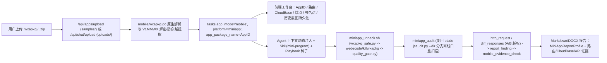

# 微信小程序渗透全流程调研与工程实现方案（2026-11-28）

> **对标与参考基线**：`Pojun` 小程序调研与集成文档（`docs/小程序渗透能力完整方案-2026-11-23.md`、`docs/小程序渗透平台集成勘察-2026-11-23.md`、`docs/小程序包格式与工具链深调研-2026-11-23.md`）× `BLADE` `aab7ec5d` 移动端底座
> **适用目标**：微信小程序（`.wxapkg` 明文包、PC 端 `V1MMWX` 加密包、含多包/分包的 `.zip` 压缩包、`CloudBase` 云开发、`web-view`、小程序插件及配套后端 API）
> **文档状态**：方案已定稿并完成前后端、数据库播种、Agent 工具链与 `skills/mini-program/` 落地。

---

## §0 执行摘要与确认设计决策

1. **核心思路（包是入口，后端与云开发才是主战场）**：微信小程序安全测试主战场不在客户端本地权限，而在 **API 鉴权缺失 / 水平垂直越权 / 业务逻辑漏洞 / 前端签名伪信任 / CloudBase 安全规则与云函数误配 / 硬编码 AppSecret 与第三方密钥**。
2. **已确认架构决策（三大施工原则）**：
   - **全栈双通道上传 + 完整前端 UI**：同时支持「任务创建弹窗 / 移动端工作台上传 `.wxapkg`/`.zip`（含可选 `AppID` 传参）走 `/api/apps/upload` → `tasks/<id>/samples/`」，以及「对话 / 任务附件走 `/api/chat/upload` → `uploads/` + `Skill("mini-program")` + `miniapp_audit`」。
   - **工作台视觉与状态持久化增强**：前端「移动端工作台」针对 `platform == "miniapp"` 渲染小程序画像卡（`AppID`、加密模式、页面/分包路由、`CloudBase` 环境/云函数/数据集合），并实现 `decompile_audit`（含 `sign_candidates` 与 `risks`）和 `tasks/<id>/screenshots/` 历史截图在页面刷新后自动回显。
   - **工具链与许可证隔离边界**：
     - `Ackites/KillWxapkg v2.4.1`（**MIT**）：通过 `scripts/build-killwxapkg.sh` 与 `Dockerfile` 多阶段构建（`killwxapkg-builder`）静态编译为独立 CLI `/usr/local/bin/killwxapkg` 并随附 `LICENSE`；但因上游包可能含 `../` 路径穿越与“失败仍返回退出码 `0`”问题，严禁直接信任其退出码，必须前置 Go/Python 安全校验与后置产物质量门禁。
     - `wedecode` / `unveilr`（**GPL-3.0**）：仅在宿主机/运行环境中存在时作为**独立外部进程**调用以提升 WXML `{{}}` 还原率，不链接、不修改、不捆绑分发。
     - **零外部依赖保底链路**：无任何第三方解包 CLI 时，Go 原生 `mobile/wxapkg.go` 与 Python `skills/mini-program/scripts/wxapkg_safe.py` 均可在零外部工具下独立完成 `V1MMWX` 解密与安全提取（直接审计 JS / JSON / WXML 等明文逻辑）。
3. **BLADE 工具契约红线**：严格通过 `server/skill_tool_drift_test.go`（`TestSkillsDoNotReferenceMissingTools`）门禁——`skills/mini-program/` 及提示词绝不引用 `save_evidence`、`search_vulns`、`listener_start` 等已退役名称，全面映射为 BLADE 真实工具（`mobile_decompile_audit`、`miniapp_audit`、`record_fact`、`insert_assets`、`traffic_search`、`traffic_get`、`bind_finding_traffic`、`http_request`、`diff_responses`、`mobile_evidence_check`、`verify_evidence`、`report_finding`）。

---

## §1 整体架构与数据流

---

## §2 分层设计详述与实现落点

### 2.1 小程序核心解析与安全解包层（`mobile/`）

| 文件 | 核心符号与职责 |
| --- | --- |
| [mobile/types.go](../mobile/types.go) | 新增常量 `PlatformMiniApp = "miniapp"` 与 `MiniAppSummary` 结构体（`AppID`、`ContainerType`、`EncryptionDetected`、`FileCount`、`Routes`、`SubPackages`、`Plugins`、`CloudEnvs`、`CloudFunctions`、`CloudCollections`、`QualityStatus`、`QualityScore`），挂载至 `PackageMetadata.MiniApp`。 |
| [mobile/wxapkg.go](../mobile/wxapkg.go) | 纯 Go 零依赖核心引擎：• `DetectWxapkgKind` / `HasWxapkgMagic`：识别 `V1MMWX`、`plain`（`0xBE`/`0xED`）、`mac_legacy` 与含 `.wxapkg` 的 `.zip` 压缩包。 • `ExtractWeChatAppID`：按 `wx[0-9a-f]{16}` 提取并明确拒绝把个人微信号 `wxid_...` 当作 `AppID`。 • `DecryptV1MMWX`：`PBKDF2-HMAC-SHA1`（`salt="saltiest"`, iter=`1000`, key=`32B` via `golang.org/x/crypto/pbkdf2`）+ `AES-256-CBC` 解密前 `1024B` 取 `1023B`，余下字节与 `appID[len-2]` 异或后校验 `0xBE/0xED`。 • `ParseWxapkg` & `SafeExtractWxapkgData`：兼容 `14/18 + indexLen + bodyLen` 结构，使用 `sanitizeWxapkgEntryName` 剥离合法前导 `/` 并拦截 `..`、盘符、UNC、控制字符与体积/数量炸弹。 • `inspectMiniAppPackage` & `InspectMiniAppBuffers`：解析 `app.json`/`app-config.json` 页面路由/分包/插件、`wx.cloud` 环境/云函数/集合、`wx.request`/`web-view` 端点与脱敏密钥（前 4 后 4）。 |
| [mobile/ingest.go](../mobile/ingest.go) | 新增 `InspectPackageWithHint(path, hintAppID)`：支持为加密包传入人工/表单 `hintAppID`，统一分发 `.wxapkg` 与含 `.wxapkg` 的 `.zip`。 |
| [mobile/decompile.go](../mobile/decompile.go) | • `DecompileOptions.HintAppID` + `extractMiniAppSample`：对小程序优先完成 V1MMWX 解密与安全提包，辅以 `quality_gate`（`full`/`partial_packed`/`raw_only`）。 • 白盒扫描扩展：纳入 `.wxml`/`.wxss`/`.wxs`/`.map` 源码扩展名，补充 `reSignKeyword`（`sign`/`hmac`/`md5`/`CryptoJS`/`wx.requestPayment` 等）与 `whiteboxLineRisks`，产物规范落盘 `tasks/<id>/mobile_audit/{manifest.json,report.json,endpoints.txt,secrets.txt}`。 |
| [mobile/wxapkg_test.go](../mobile/wxapkg_test.go) | 构造明文包、`V1MMWX` 加密包、含 `../evil_poc.txt` 恶意条目的包与多包 `.zip`，验证解密往返一致、路径穿越拒绝与 `DecompileAndAudit` 完整闭环。 |

### 2.2 数据库、技能绑定与 Playbook 种子层（`db/`）

| 文件 | 核心设计与实现 |
| --- | --- |
| [db/db.go](../db/db.go) | 在 `builtinSkillVisibility` 中新增 `"mini-program": {"pentest", "worker"}`，并在 `seedBuiltins()` 中调用 `d.seedMiniAppTaskPlaybooks()`。 |
| [db/task_playbook_seed.go](../db/task_playbook_seed.go) | **独立开关隔离升级**：保留既有 `task_playbooks_mobile_v1` 不变，使用独立设置键 `"task_playbooks_miniapp_v1"` 幂等写入 `builtinMiniAppPlaybooks`（`Playbook：微信小程序全流程渗透（解包 + 云开发 + A/B 越权 + SRC 报告）`），提示流程全部使用 BLADE 原生工具名。 |
| [db/task_playbook_miniapp_test.go](../db/task_playbook_miniapp_test.go) | 在真实 PG 测试库验证当 `task_playbooks_mobile_v1=done` 时，`seedMiniAppTaskPlaybooks()` 仍能幂等插入模板且二次执行不重复。 |

### 2.3 Agent 工具集与上下文协同层（`agent/`）

| 文件 | 核心设计与实现 |
| --- | --- |
| [agent/tools_jsaudit.go](../agent/tools_jsaudit.go) | **保持 `js_audit` 参数 Schema 100% 不变**；向后扩展内嵌 `jsAuditScript`，支持 `--dir <dir>`、`--appid <wx...>`、`--no-osv` 与 `extract_miniapp_dir(...)` 分支（递归扫描 JS/JSON/WXML/WXSS/WXS/Map 并输出掩码 secrets、CloudBase 与 endpoints），并将收尾提示词全面切换为 `record_fact` / `insert_assets` / `report_finding`（零 `save_evidence`）。 |
| [agent/tools_miniapp.go](../agent/tools_miniapp.go) | 新增只读工具 `miniapp_audit`（`(t *ToolSet) miniappAudit()`）：严格校验 `dir`（通过 `filepath.EvalSymlinks` 与相对路径判断禁止跳出 `taskRoot`），按需部署 `blade-jsaudit.py` 并生成沙箱可执行的 `--dir ... --out <runDir>/miniapp-audit` 命令。 |
| [agent/tools_insert.go](../agent/tools_insert.go) & [agent/toolcatalog.go](../agent/toolcatalog.go) | 在 `WorkerTools()` 与内置 `"pentest"` agent 工具目录中注册 `t.miniappAudit()`。 |
| [agent/mobile.go](../agent/mobile.go) | 更新 `mobilePlannerContextBlock` 与 `mobileWorkerContextBlock`：识别小程序任务后指导优先加载 `Skill("mini-program")`，结合 `mobile_decompile_audit` / `miniapp_audit` 与 A/B 双身份验证及 `mobile_evidence_check` 完成闭环。 |
| [agent/miniapp_test.go](../agent/miniapp_test.go) | 覆盖 `miniapp_audit` 目录边界拒绝与命令生成、真实 Python `--dir` 扫库脱敏校验，以及 `wxapkg_fixture.py -> miniapp_unpack.sh -> miniapp_audit` 全链路端到端验证。 |

### 2.4 服务端 API、宿主工具探测、构建镜像与报告层（`server/` + `report/` + `scripts/` + `Dockerfile`）

| 文件 | 核心设计与实现 |
| --- | --- |
| [server/app_upload.go](../server/app_upload.go) | 上传白名单纳入 `.wxapkg` 与通过 `mobile.HasWxapkgMagic` 校验的小程序 `.zip`；支持从表单/Query 读取可选 `appid` 并调用 `mobile.InspectPackageWithHint`；创建任务时写入 `app_mode="mobile"`、`app_platform="miniapp"`、`app_package_name=AppID` 与初始路由/CloudBase `Fact`。 |
| [server/mobile_api.go](../server/mobile_api.go) | • `getTaskMobileState`：在响应中持久化返回 `decompile_audit`（读取 `tasks/<id>/mobile_audit/report.json`）与 `screenshots`（列出 `tasks/<id>/screenshots/*.png`）。 • 新增只读接口 `GET /api/tasks/{id}/mobile/screenshots/{name}`（`getTaskMobileScreenshot`）返回持久化截图。 • `Audit` 与 `handleTaskMobileDecompileAudit` 支持可选 `appid` 覆盖猜测。 |
| [server/hosttools_api.go](../server/hosttools_api.go) | 在 `hostToolCatalog` 增加 `killwxapkg`（`--help`）与 `wedecode`（`--version`）只读状态探测。 |
| [report/report.go](../report/report.go) & [server/report_api.go](../server/report_api.go) | 新增 `MiniAppReportProfile`：当 `Platform == "miniapp"` 时在交付报告输出小程序 `AppID`、容器/加密态、路由/分包统计与 CloudBase 攻击面概览，并屏蔽无意义的 Android `Manifest`/签名条目。 |
| [scripts/build-killwxapkg.sh](../scripts/build-killwxapkg.sh) & [Dockerfile](../Dockerfile) | 新增独立交叉编译脚本与 `Dockerfile` 首阶段 `killwxapkg-builder`（静态编译 MIT 许可 `Ackites/KillWxapkg v2.4.1` 至 `/usr/local/bin/killwxapkg` 并随附 `LICENSE`）。 |
| [server/mobile_decompile_api_test.go](../server/mobile_decompile_api_test.go) & [report/report_test.go](../report/report_test.go) | `TestMiniAppUploadStatePersistenceAndScreenshotRoute` 验证 `.wxapkg` 上传、持久化 `decompile_audit` 与截图列表/PNG 下载路由；`TestMarkdownMobileProfileSection` 验证小程序报告输出与 Android 字段隔离。 |

### 2.5 Skill 知识体系（`skills/mini-program/`）

- [skills/mini-program/SKILL.md](../skills/mini-program/SKILL.md)：全流程实战作业规范（PC 微信/模拟器/真机抓包差异、`V1MMWX` 与明文判别、`mobile_decompile_audit` / `miniapp_audit` 双入口、`CloudBase`/开放能力/10 态越权与 `mobile_evidence_check` 质检），**零退役工具名**。
- `skills/mini-program/scripts/`：`miniapp_unpack.sh`（安全解包 + 质量阶梯 + 门禁调度）、`wxapkg_safe.py`（纯 Python 安全解包与防穿越）、`quality_gate.py`（WXML/JS/路由质量评分，防信工具退出码）、`wxapkg_fixture.py`（合成测试夹具生成）。
- `skills/mini-program/references/`：`13` 篇专项参考文档（`00-overview.md` 至 `12-sources.md`），按需按章节检索，避免上下文膨胀。

### 2.6 前端感知与工作台升级（`web/`）

| 文件 | 核心设计与实现 |
| --- | --- |
| [types.ts](../web/src/lib/types.ts)、[api.ts](../web/src/lib/api.ts)、[handler.ts](../web/src/lib/mock/handler.ts) | 同步扩展 `MiniAppSummary`、`DecompiledSecret`（`masked`/`entropy`/`snippet`）、`DecompiledSignCandidate`（`hint`/`snippet`）、`DecompiledCodeRisk`（`risks`）、`TaskMobileState`（`decompile_audit`/`screenshots`）；`uploadAppPackage` 与 `runTaskMobileDecompileAudit` 支持可选 `appId`/`appid`；新增 `taskMobileScreenshotUrl`。 |
| [create-task-sheet.tsx](../web/src/app/(main)/function/tasks/_components/create-task-sheet.tsx) | 上传模式卡片扩展为 **「移动 APP / 小程序（APK / IPA / WXAPKG）」**，`accept` 新增 `.wxapkg,.zip`；提供可选 `AppID` 输入框（用于 `V1MMWX` 解密提示）及上传成功后的小程序路由/CloudBase/加密态预览卡。 |
| [mobile-workbench-tab.tsx](../web/src/app/(main)/function/tasks/detail/_tabs/mobile-workbench-tab.tsx) | • 自动回显持久化 `state.decompile_audit` 与 `state.screenshots`（刷新页面不丢失）； • 针对 `miniapp` 平台展示专属 `AppID`、加密态、页面/分包路由与 `CloudBase` 资产区并隐藏纯 Android 标签； • 审计面板完整呈现 `endpoints`、`secrets`、`sign_candidates` 与 `risks`，真机/交互区新增历史截图缩略图预览。 |

---

## §3 质量门禁与自动化验证清单

| 检查项 | 执行命令 / 范围 | 最新实测结果 |
| --- | --- | --- |
| Go 格式与静态分析 | `gofmt -l mobile/ toolpolicy/ agent/ report/ server/ db/ cmd/ intercept/ traffic/` & `go vet ./...` | 零格式差异，`go vet` 退出码 `0` |
| Go 核心包竞态测试 | `go test -race -count=1 -p 1 ./mobile/... ./toolpolicy/... ./intercept/... ./report/...` 与 `./agent/...` | `mobile` `1.185s`、`intercept` `2.337s`、`report` `1.045s`、`agent` `4.683s` 全通过（`toolpolicy` 无测试文件） |
| Server 隔离 PG 与 Skill 门禁 | `BLADE_REQUIRE_TESTS=1 go test -race -count=1 -p 1 ./server/...` 定向验证上传/持久化/报告接口（7 项）与 `'Skill'`（18 项，含 `TestSkillsDoNotReferenceMissingTools`） | `6.554s` / `5.307s` 全部通过（注：均为 `-run` 定向筛选） |
| DB 隔离 PG 与播种测试 | `BLADE_REQUIRE_TESTS=1 go test -race -count=1 -p 1 ./db/... -run 'TestMiniApp\|TestMobile\|TestTaskTemplate\|TestFindings\|TestBuiltin\|TestColdCoffee'` | 5 项全部通过（`3.099s`，含 `TestMiniAppPlaybookAndSkillVisibilitySeed`） |
| 前端检验与静态产物嵌入 | `npx biome check --diagnostic-level=error ...`、`npx tsc --noEmit`、`npm test`、`npm run build:static`、`rsync -a --delete web/out/ server/webui/dist/` | `biome` 0 错误、`tsc` 0 错误、`129/129` 单测通过、`48/48` 静态页面导出并同步 |
| 嵌入式单二进制编译 | `CGO_ENABLED=0 go build -tags embedui -o /tmp/blade-verify ./cmd/blade` | 退出码 `0`（注：`Dockerfile` 镜像构建未在本地执行） |
