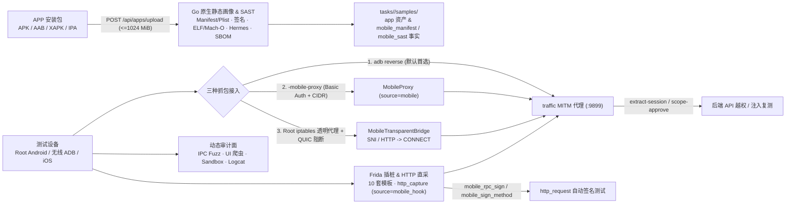

# BLADE 移动 APP 安全测试使用与架构说明

BLADE 支持对 **Android（`.apk` / `.aab` / `.xapk` / `.apkm` / `.apks`）** 与 **iOS（`.ipa`）** 应用开展动静态一体化的安全评估，覆盖：**大包流式上传与静态 SAST/原生二进制画像 → USB / Wi-Fi / Root `iptables` 透明代理抓包 → Frida 绕过与直采 → 批量 IPC Fuzz / UI 状态机爬虫 / Root 沙箱与 Logcat 审计 → 真机登录态同步及携带 Frida RPC 自动签名的后端 API 复测**。

为保证非移动端渗透任务零额外负载，移动端执行工具与提示词上下文采用**按需动态注入**：仅当任务绑定移动设备或样本时开放相应面，不污染默认对话前缀与工具列表。

---

## 一、整体测试闭环

---

## 二、快速上手流程（UI 操作路径）

### 1. 上传样本并创建移动测试任务
1. 进入「任务管理 → 新建任务」，将场景切换到 **「移动 APP 安全测试」**。
2. 上传 `.apk` / `.aab` / `.xapk` / `.apkm` / `.apks` 或 `.ipa` 安装包（由 `POST /api/apps/upload?scope=staging|task&id=<id>` 流式落盘，上限 **1024 MiB**，单独放宽 20 分钟读超时）。
3. 系统即时返回静态预检摘要：包名 / Bundle ID、版本号、签名方案、加壳与跨平台框架、导出组件、DeepLink、候选后端域名及静态 SAST 发现。
4. 按需勾选候选后端域名加入 `task_scope`，并可直接在建任务时绑定已接入设备；任务初始化时 `prepareTaskMobileSamples` 会自动将样本归位到任务工作目录 `tasks/<id>/samples/`，写入 `app` 资产，并将 manifest 摘要与 High/Medium 级别 SAST 发现写入任务事实图谱（`category="mobile_manifest"` / `category="mobile_sast"`）。

### 2. 接入设备与安装 CA 证书
在「流量监控 → 设备接入与 CA 证书」向导或任务详情 **「移动控制台」** 页签完成设备与抓包准备：
- **USB 设备（推荐，零外网暴露）**：宿主机通过 USB 连接真机或启动模拟器后，使用「一键 `adb reverse` 代理」将设备回环端口映射到 BLADE 本地 MITM 端口（`-proxy`，默认 `127.0.0.1:9899`）。
- **无线 ADB / 局域网测试机**：使用「连接/配对设备」输入 `ip:port` 或 Android 11+ 配对码接入；可通过「LAN 移动代理」动态启停带来源 CIDR 白名单与高熵随机 `Proxy-Authorization` 凭据的受控代理。
- **Root Android 一键推入系统 CA**：点击推送系统 CA 后，后台依据设备环境自动适配 **Android 14+ `/apex/com.android.conscrypt/cacerts`（tmpfs + `nsenter` 挂载 zygote/zygote64 命名空间）** 或传统 **`/system/etc/security/cacerts`**。
- **非 Root / iOS 证书分发**：通过 `/api/traffic/ca?fmt=pem|crt|android|mobileconfig` 下载，或扫描向导生成的一次性 HMAC 令牌链接 / 在配置代理后访问代理内门户页自安装。

### 3. 动态绕过、交互抓包与后端联动
- 当流量页或设备状态出现 **Pinning 告警**（TLS 握手即断开）或遇 Flutter / Cronet / 原生 Socket 无视系统代理时：
  - 若目标忽略系统 `http_proxy`，在 Root 设备一键启用 **`transparent`（`iptables` 透明代理 + QUIC UDP 443 阻断降级）**。
  - 若目标校验证书或使用底层 `libflutter.so` / BoringSSL，启用 **`ssl_unpinning`**、**`flutter_ssl_bypass`** 或 **`native_tls_hook`**（开启 `native_tls_hook` 后，绕过代理的 `SSL_write`/`SSL_read` 明文可自动写入流量库并标记 `source="mobile_hook"`）。
- 在真机完成登录后，点击 **「抽取登录态」**（`POST /api/tasks/{id}/mobile/extract-session`）聚类认证头与 Token，并可按需使用 **「批量 IPC Fuzz」**、**「UI 自主爬虫」**、**「Root 沙箱与 Logcat 审计」** 或在 Frida 中导出签名函数并与 `http_request` 联动执行接口复测。

---

## 三、核心能力详解

### 1. 静态解包、原生二进制与 SAST 画像 (`mobile/`)
所有样本预检在 Go 进程内原生完成（内置 Zip-Slip 路径防护与有界读取），不强制依赖外部反编译器：

| 审计维度 | 实现入口 | 提取与检查内容 |
| --- | --- | --- |
| **Android Manifest & 签名** | `mobile/axml.go` · `mobile/sast.go` | 二进制 AXML / 明文 XML 解析：包名、SDK、`debuggable`、`allowBackup`、`usesCleartextTraffic`、`networkSecurityConfig`、`requestLegacyExternalStorage`、`exported="true"` 组件（含 `taskAffinity`、`launchMode`、`readPermission`、`writePermission`、`grantUriPermissions`）与 DeepLink；`InspectAPKSignatures` 识别 v1 JAR 与 APK Signing Block v2/v3，提示仅 v1 签名存在的 Janus（CVE-2017-13156）风险。 |
| **iOS Plist / Provisioning / Mach-O** | `mobile/plist.go` | `ParseInfoPlist` 解析 XML / `bplist00` 的 `CFBundleIdentifier`、URL Scheme 与 ATS 配置；`ParseMobileProvision` 从 CMS 提取 Entitlements 与 `applinks:` 关联域；`InspectMachOBinary` / `CheckMachOFairPlayEncrypted` 基于 `debug/macho` 检查 `LC_ENCRYPTION_INFO*` FairPlay 加密状态与 PIE/NX/ARC/Canary。 |
| **Native ELF 加固与 JNI** | `mobile/sast.go` | `InspectELFBinary` 基于 `debug/elf` 识别 PIE、NX（`PT_GNU_STACK`）、RELRO、Stack Canary（`__stack_chk_fail`）、RPATH/RUNPATH、`JNI_OnLoad`、`Java_*` 原生接口与 SBOM 三方组件版本线索（OpenSSL / BoringSSL / libcurl / SQLite / OkHttp / FFmpeg 等）。 |
| **跨平台引擎与资源规则 SAST** | `mobile/ingest.go` · `mobile/sast.go` | `ExtractHermesStrings` 识别 React Native Hermes 字节码（`hermesMagicBytes`）并抽取域名与线索；扩展扫描 `.so`、`res/xml/*.xml`、`assets/**/*.js|html|properties|yaml` 与 `global-metadata.dat`；`RunStaticSAST` 执行规则化 MASVS 检查并按严重度输出 `StaticFinding`。 |

### 2. 受控抓包平面与透明引流 (`traffic/` · `mobile/device.go` · `cmd/blade/`)
BLADE 严格遵循默认环回零暴露原则（P42）：`-proxy` 默认固定 `127.0.0.1:9899`，若绑定非环回且未显式传入 `-allow-open-proxy` 将拒绝启动。针对移动端提供三类受控接入路径：

1. **`usb_reverse`（ADB 反向隧道）**：通过 `adb reverse` 将设备端回环端口直接转给宿主机 `-proxy`，`settings put global http_proxy` 指向设备 `127.0.0.1:<port>`，退出或 `disable` 时恢复原代理快照。
2. **`lan`（受鉴权局域网代理）**：由 `-mobile-proxy` / `-mobile-proxy-cidrs` 启动参数或流量页动态开关控制 `traffic.MobileProxy`，强制要求来源 IP 命中允许 CIDR（默认私网网段与 loopback）且携带随机生成的高熵 `Proxy-Authorization` Basic Auth 凭据，未授权固定返回 `407 Proxy Authentication Required`，记录流量标引 `source="mobile"`。
3. **`transparent`（Root `iptables` 透明代理）**：
   - 在 Root 设备上通过 `adb reverse` 打通桥接端口，并在 `nat/OUTPUT` 注入可逆规则链 **`BLADE_PROXY`**（放行回环与私网保留地址 `127.0.0.0/8`、`10.0.0.0/8`、`172.16.0.0/12`、`192.168.0.0/16`，其余 TCP 80/443 重定向至桥接端口），同时在 `filter/OUTPUT` 注入 **`BLADE_QUIC`**（对 UDP 443 回复 `icmp-port-unreachable` 迫使 HTTP/3/Cronet 降级回 TCP/TLS）。
   - 宿主机 `traffic.MobileTransparentBridge` 对首包按实际 TLS Record 长度提取 SNI（`ExtractTLSSNI`）或解析明文 HTTP 请求行后，自动向 `go-mitmproxy` 发起携带 `X-Blade-Traffic-Source: mobile` 头的 `CONNECT` 会话；切换或执行 `ClearProxy` 时完整移除 `BLADE_PROXY`、`BLADE_QUIC` 与反向映射。
- **移动端流量专项增强**（`traffic/mobile_ext.go`）：支持 `source`（`web` / `mobile` / `mobile_hook`）过滤、`exclude_noise` 系统噪声主机过滤、Pinning 客户端 TLS 断连告警聚合、`WebSocket` / `SSE` 长连接帧落库，以及 `application/grpc` / `application/x-protobuf` 的启发式 `DecodeProtobufPreview` 视图。

### 3. Frida 动态模板、直采通道与 RPC 自动签名 (`mobile/frida.go` · `agent/`)
内置 10 套标准化模板（由 `mobile_frida_hook` 工具或工作台调用，默认优先 `spawn` 模式防止错过早期校验）：

| 模板 ID | 作用说明 |
| --- | --- |
| `ssl_unpinning` | Java 层常见网络栈（OkHttp3 / TrustManager / Conscrypt / WebViewClient）及 ProGuard/R8 混淆类动态扫描绕过 |
| `flutter_ssl_bypass` | 跨架构定位 `libflutter.so` BoringSSL 验证点并绕过证书校验 |
| `native_tls_hook` | Hook 原生 `SSL_CTX_set_custom_verify` 与 `SSL_write` / `SSL_read`，将绕过系统代理的 TLS 明文通过 `tag="http_capture"` 回传并由 `RecordSyntheticMobileExchange` 直写 SQLite（`source="mobile_hook"`） |
| `anti_detection` | Java 与原生 `libc.so` `strstr` / `__system_property_get` 的 Root / Frida / 调试特征掩码 |
| `crypto_monitor` | 监听 `Cipher.doFinal` / `MessageDigest` / `Mac` 明文、密钥与 IV |
| `okhttp_plaintext` | 拦截加解密前后的 OkHttp 明文日志 |
| `webview_bridge` | 跟踪 `loadUrl` 与反射检查 `@JavascriptInterface` 暴露方法及安全设置 |
| `storage_crypto_audit` | 运行时监控文件/数据库读写及密钥库调用 |
| `flag_secure_bypass` | 解除窗口 `FLAG_SECURE` 截屏/录屏限制以便动态取证 |
| `socket_traffic_tap` | 采集非标准代理或原生直接发起的 Socket 通信事件 |

**请求自动签名联动**：测试带签名或加密 Body 的后端接口时，可在 Frida 自定义脚本通过 `rpc.exports` 暴露签名方法，并在调用 `http_request` 工具时传入可选参数 `mobile_sign_method`（及可选 `mobile_sign_session`）。`doHTTP` 发送前自动触发 RPC 重算签名头/查询串/Body；`applyMobileRPCSignResult` 支持解包服务端 `{"method","result"}` 外壳，并强制校验返还 URL 与原请求**同主机名**（禁止意外跨主机重定向导致 SSRF）。

### 4. 动态交互探索与 Root 本地审计 (`mobile/audit.go` · `mobile/ui.go`)
- **IPC 探测与批量 Fuzz（`mobile_ipc_probe`）**：支持 `activity`、`service`（`am startservice`）、`deeplink`、`broadcast`、`provider` 单点探测及 **`auto_fuzz`**（默认最多 `25` 轮，上限 `60`）。`FuzzIPC` 自动从样本清单读取已导出组件与 Scheme，组合畸形参数/边界 Payload 并识别 `SecurityException` / `Permission Denial` 与越权放行风险。
- **有界自主 UI 状态机爬虫（`CrawlUI`）**：通过 `mobile_ui_explore(action="auto_crawl")` 触发（默认 `12` 步，上限 `40`），基于控件树指纹循环遍历当前界面的可点击控件、离开目标 APP 自动 `back` 归位，内置 `dangerousText` 安全名单主动跳过「注销」「退出」「删除」「清空」「销毁」「支付」「立即付款」「确认支付」「转账」「卸载」（含对应英文动作），并输出去重页面数与爬行期间流量增量（`traffic_delta`）。
- **Root 沙箱与 Logcat 审计**：
  - `AuditSandboxStorage` 检查 `/data/data/<pkg>/` 的 `shared_prefs`、`databases/`（通过文件头魔数区分明文 `SQLite format 3` 与加密库）以及 `/sdcard/Android/data/<pkg>/` 外置明文，正则检出 Bearer/Basic/JWT/常见密钥泄露线索。
  - `CaptureLogcatAudit` 结合目标 UID 与包名过滤日志，归类潜在敏感 Token、内/外网 URL 与异常堆栈（最多采集 50 条截断摘要）。

---

## 四、智能体工具门控与 HTTP API 速查

### 1. 智能体动态工具集（`toolpolicy/toolpolicy.go` · `agent/mobile.go`）
以下 7 个工具全部绑定 `RequiresSetting: "task_mobile_device"`，仅在任务绑定有效设备时暴露，并统一将设备状态、SAST/组件画像接入 `DynamicBoundary` 之后（Planner）及 Worker 执行轮次：

| 工具名 | 权限策略 | 核心 `action` / `kind` 能力 |
| --- | --- | --- |
| `mobile_device_status` | `Read` | 查询绑定设备 ADB 状态、型号、系统版本、Root、系统 CA、Frida PID、前台包名与代理 |
| `mobile_app_ctrl` | `Action` (`InterceptDefault`, `Footprint`) | `install` / `uninstall` / `clear_data` / `push_ca` / `list_sandbox` / `read_sandbox` / `sandbox_audit` / `logcat_audit` / `static_audit` |
| `mobile_proxy_ctrl` | `Action` (`InterceptDefault`) | `enable_usb` / `enable_transparent` / `enable_lan` / `disable` / `pinning_alerts` / `clear_alerts` |
| `mobile_ui_explore` | `Action` (`InterceptDefault`) | `dump` / `auto_crawl` / `launch` / `deeplink` / `tap` / `input` / `swipe` / `back` / `home` / `force_stop` |
| `mobile_frida_hook` | `Action` (`InterceptDefault`, `Footprint`) | `start_server` / `start` / `logs` / `stop` / `list` / `catalog` |
| `mobile_rpc_sign` | `Action` (`InterceptDefault`) | 调用活跃 Frida 会话 `rpc.exports` 导出函数 |
| `mobile_ipc_probe` | `Action` (`InterceptDefault`, `Footprint`) | `activity` / `service` / `deeplink` / `broadcast` / `provider` / `auto_fuzz` |

### 2. HTTP 工作台与抓包 API（`server/mobile_api.go` · `server/traffic_api.go` · `server/routes_exploration.go`）

- **样本上传与设备池**：
  - `POST /api/apps/upload?scope=staging|task&id=<id>`
  - `GET /api/mobile/devices`、`POST /api/mobile/devices/connect`、`DELETE /api/mobile/devices/{serial}`、`GET /api/mobile/frida/scripts`
- **任务级移动控制台**（`/api/tasks/{id}/mobile/...`）：
  - `GET /state`、`POST /static-audit`
  - `POST /bind`、`POST /unbind`
  - `POST /install`、`POST /ca-push`、`POST /proxy`
  - `POST /frida/server`、`POST /frida/start`、`POST /frida/stop`、`POST /frida/rpc`
  - `GET /screen`、`POST /ui`、`POST /ui-crawl`
  - `POST /ipc-probe`、`POST /ipc-fuzz`
  - `GET /sandbox`、`POST /storage-audit`、`GET /logcat`
  - `POST /extract-session`、`POST /scope-approve`
- **流量证书、LAN 代理与告警**：
  - `GET /api/traffic/ca?fmt=pem|crt|der|android|0|mobileconfig|ios`
  - `GET /api/traffic/mobile-setup`、`POST /api/traffic/mobile-proxy`
  - `GET /api/traffic/pinning-alerts`、`DELETE /api/traffic/pinning-alerts`

---

## 五、源码结构与外部环境前提

### 1. 代码模块对照
- `mobile/`：`types.go`、`ingest.go`、`axml.go`、`plist.go`、`sast.go`、`device.go`、`ui.go`、`frida.go`、`audit.go`
- `traffic/`：`traffic.go`、`mobile_proxy.go`、`mobile_ext.go`、`mobile_transparent.go`
- `db/`：`schema.sql`（`mobile_devices` 表及 `tasks` 移动扩展列）、`mobile.go`、`tasks.go`
- `toolpolicy/` & `agent/`：`toolpolicy.go`、`mobile.go`、`tools_http.go`、`planner.go`、`worker.go`、`mainagent.go`
- `server/`：`app_upload.go`、`mobile_api.go`、`traffic_api.go`、`routes_exploration.go`、`manager.go`、`hosttools_api.go`
- `cmd/blade/`：`main.go`（`-mobile-proxy` / `-mobile-proxy-cidrs` 与 P42 校验）
- `web/`：`src/app/(main)/function/tasks/_components/create-task-sheet.tsx`、`src/app/(main)/function/tasks/detail/_tabs/mobile-workbench-tab.tsx`、`src/app/(main)/function/traffic/page.tsx`、`src/lib/types.ts`、`src/lib/api.ts`、`src/lib/mock/handler.ts`

### 2. 外部依赖与容器环境
- 运行期依赖探测清单在 `server/hosttools_api.go` 的 `hostToolCatalog` 中维护，移动端相关命令行包括：`adb`、`java`、`jadx`、`apktool`、`aapt2`、`apksigner`、`zipalign`、`frida`、`objection`、`radare2`、`ideviceinfo`、`iproxy`。
- 官方容器镜像定义（`Dockerfile`）已钉版本预装 `adb`、`apksigner`、`aapt`、`zipalign`、`radare2`、`libimobiledevice-utils`、`openjdk-17-jre-headless`、`jadx`（`1.5.6`）、`apktool`（`2.11.1`）以及 `frida==16.7.19` / `frida-tools==13.7.1`；容器连接宿主机 ADB 可通过 `docker-compose.yml` 中的 `ADB_SERVER_SOCKET` 透传。
- **裸机常见排查**：若本地仅安装部分 CLI 工具（如只有 `adb`、`radare2`），纯 Go 静态画像与基础 ADB 控制仍可正常工作，但 Frida 动态插桩 / `native_tls_hook` / RPC 签名需要宿主机安装 `frida` 并在测试机推送启动对应架构的 `frida-server`。
